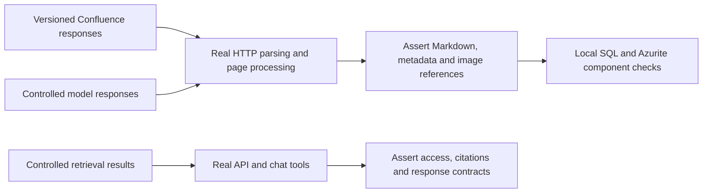
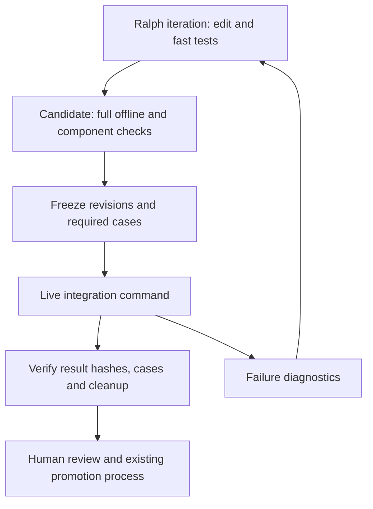

# Fast development loops and full integration gates

**Status: Draft - for human review**

**Date:** 2026-10-19

**Feature ID:** `cuttle-development-test-loops` (proposed; no matching existing feature found).

**Request:** Make CuttleCode Ralph iterations fast without removing the full integration test cycle. Confluence image processing is a separate feature.

**Target branch:** Not selected. Recommend the shared delivery line for this tooling; confirm `main` versus `emerie` before implementation. No branch was changed.

**Spec Kit:** This is an options/design draft. This feature has no `spec.md`, `plan.md`, or `tasks.md` yet. Prepare and review them before implementation. This document does not replace their review.

**Reference:** [Content image indexing design](../content-image-indexing-iteration-1/design.md) and its [manual validation plan](../content-image-indexing-iteration-1/testing.md). Their implementation status does not apply to this proposal.

## 1. Recommendation and outcome

**Proposed decision:** Separate development feedback from release evidence. Use three levels of tests and one common command contract. Cuttle coordinates work; versioned test programs decide whether checks pass.

| Level | When | Real components | Replaced dependencies | Initial performance target, not measured |
| --- | --- | --- | --- | --- |
| Fast | Each Ralph iteration | Changed business logic, parsers, serializers, tool/citation composition | Confluence HTTP, Search results, model responses, storage as needed | Selected tests within 60 seconds after restore/build caches are warm |
| Component | Relevant changes and every candidate | API/worker code, SQL Server, Blob/Table adapters through Azurite, local HTTP contracts | External Confluence, Search, embeddings, vision/chat models | Within 5 minutes after local services are ready |
| Live integration | Candidate completion, before merge; broader suite nightly | Small Confluence corpus, real storage, Search/indexer, deployed candidate skills/workers/API, real models, authenticated client | None for the required end-to-end scenario | 10–30 minute planning range; 30-minute execution deadline initially |

Cold builds, resource provisioning, and queue time are measured separately. These are proposed targets to calibrate, not service guarantees or observed timings.

Before: a page-processing edit needs a remote sync and indexer cycle before the developer can inspect the result. After: the developer runs a captured page response through the real conversion code and compares its Markdown, metadata, and image references locally. A completed candidate must also prove that a newly changed synthetic page becomes searchable through the real chain.

Goals: zero external service calls in fast tests; repeatable failures; short local feedback; exact candidate revisions in evidence; no full-corpus resync per iteration; no candidate reported as fully validated while required live checks are missing.

Non-goals: implement Confluence image processing, reproduce Azure ranking locally, migrate the search platform, change application authorization, approve releases, or run infrastructure and tests in this design session. This feature creates no new public product endpoint.

## 2. Inspected evidence and gaps

All entries below describe **code/configuration inspection**, including test assertions. No application tests, sync jobs, migrations, deployments, or paid model calls ran. No live environment was queried. All four checkouts had clean working trees before this draft.

| Repository | Inspected branch | Commit |
| --- | --- | --- |
| API | `feature/content-image-indexing-poc` | `74f900b25082ca6205888db375f9fba276025cd3` |
| Frontend, read only | `main` | `2315313cee49ffd091b00ba910cb7a7d8ffbeb32` |
| GitOps, read only | `master` | `d5f8d644c0d40a587b2c2e58c96d014c807ccfee` |
| Terragrunt, read only | `proposal/content-images-secret` | `5cb4dd0fcde6742d36d6b5de2f0839caf386fc92` |

Read repository and workspace agent guides, the [API constitution](../../.specify/memory/constitution.md), [README](../../README.md), project Cuttle/pipeline skills, and the isolated-browser-qa runbook. Searched the existing API specs and sibling design filenames; no matching test-loop feature was found. Source on another target branch may differ.

| Verified behavior | Evidence and implication |
| --- | --- |
| Confluence job orchestration already has test seams | [ConfluenceJobHarness](../../tests/AltusAiConfluenceSync.Tests/ConfluenceJobHarness.cs) runs the real runner with fake link, sync, space, page, document, and lease services. Reuse it for orchestration and failure reporting. It replaces the entire sync service, so it does not test real page conversion. |
| Sync success is more than an exit code | [ConfluenceIncrementalSyncJobTests](../../tests/AltusAiConfluenceSync.Tests/ConfluenceIncrementalSyncJobTests.cs), `Run_FailsOnlyTheSpace_WhoseTraversalAborted`, asserts `ExitSuccess` with `PartiallyFailed`. The gate must inspect counters, target outcomes, and content. |
| Source acquisition accepts an injected HTTP client | [ConfluenceService](../../AltusAiShared/Confluence/ConfluenceService.cs), `GetContent`, `Search`, and `GetSpaceById`, call REST endpoints. A scripted HTTP handler can exercise real request/response parsing. |
| Core sync still couples processing and external state | [ConfluenceSyncService.RunSyncJob](../../AltusAiShared/Confluence/ConfluenceSyncService.cs) reads page HTML, converts it, uploads Markdown, updates Table state, and writes SQL. [AzureTableClientHelper.InitializeTableClient](../../AltusAiShared/Confluence/AzureTableClientHelper.cs) constructs a cloud Table endpoint directly. Full local sync needs a storage seam; replacing the whole service would miss the work under test. |
| Sync identity has a collision constraint | `RunSyncJob` uses `spaceKey` as Table partition and `pageId` as row key; `ClientUniqueId` is a property/query condition, not part of the key. Concurrent test clients must not sync the same space/page into one shared state table. |
| A job can be scoped and invoked immediately | [ConfluenceIncrementalSyncJob](../../AltusAiConfluenceSync/Jobs/ConfluenceIncrementalSyncJob.cs) uses `SYNC_PARAM_CLIENT_UNIQUE_ID` and `SYNC_PARAM_DATE`. [Program](../../AltusAiConfluenceSync/Program.cs) registers one-shot jobs. The date affects the CQL window; it is not a force-reprocess switch for unchanged pages. |
| Search configuration and retrieval have useful boundaries | [IndexingService](../../AltusAiAssistantApi/Services/IndexingService.cs) names index/data source/skillset/indexer from client GUIDs and schedules indexing every 30 minutes. [IKnowledgeRetriever](../../AltusAiAssistantApi/Services/Maf/IKnowledgeRetriever.cs) serves chat; [IAnaSearchService](../../AltusAiAssistantApi/Services/IAnaSearchService.cs) serves MCP search/fetch. Their implementations construct Search clients internally. |
| Retrieval has more than one caller | [ChatToolProvider](../../AltusAiAssistantApi/Services/Maf/ChatToolProvider.cs) calls the retriever; [McpService](../../AltusAiAssistantApi/Services/McpService.cs) calls the search service. Both need fixture coverage. Replacing only one does not isolate all flows. |
| Image processing is partly testable already | [ContentImageTests](../../tests/AltusAiShared.Tests/ContentImageTests.cs) uses fake cache/storage/model implementations. [DescribeImagesTests](../../tests/AltusAiIndexerSkills.Tests/DescribeImagesTests.cs) exercises skill processing. [ContentImageIndexingTests](../../tests/AltusAiAssistantApi.Tests/ContentImageIndexingTests.cs) uses an EF in-memory database and mocked index management. These do not prove cloud extraction, SQL behavior, or deployed skill connectivity. |
| Skills need explicit local wiring | [IndexerSkills Program](../../AltusAiIndexerSkills/Program.cs) registers model/storage services, constructs cloud storage settings, checks skill codes, and bounds image requests at 40 seconds. Local Azurite requires injectable clients/endpoints in this host too. |
| Runtime authentication remains relevant | [API Program](../../AltusAiAssistantApi/Program.cs) configures JWT authentication and requires authorization on the chat hub. In-process SignalR is available without an Azure SignalR connection. A test identity in an in-process test host does not prove Entra login. |
| CI already provides an offline foundation | [test.sh](../../scripts/ci/test.sh) restores/builds/runs every `tests/*/*.csproj` and emits JUnit. [quality.sh](../../scripts/ci/quality.sh) fails on build errors but treats formatting/advisories as warnings. [Bitbucket pipeline](../../bitbucket-pipelines.yml) runs .NET 10 quality/tests before image builds on `main` and `feature/**`. |
| Existing deployment templates can support a gate | [Migration Job](../../charts/altus-ai-assistant/charts/altus-ai-assistant-api/templates/migration-job.yaml) is conditional; [API values](../../charts/altus-ai-assistant/charts/altus-ai-assistant-api/values.yaml) default it off with wave `-1`. [Confluence CronJob](../../charts/altus-ai-assistant/charts/altus-ai-confluence-sync/templates/cronjob.yaml) accepts job keys, suspension, and deadlines. This proves template behavior, not deployed readiness. |

Cross-repository evidence:

- [Frontend package](../../../altus-ai-assistant-fe/package.json) has a build script but no test script. [getRuntimeConfig](../../../altus-ai-assistant-fe/src/libs/shared/runtimeConfig.ts) gives runtime values precedence over Vite fallback values. A future browser harness must verify the resolved API address.
- [GitOps QA](../../../altus-ai-gitops/apps/payloads/ana-qa.yaml) and [sandbox](../../../altus-ai-gitops/apps/payloads/ana-qa-sandbox.yaml) configure the same Search service and Blob account. Separate namespaces therefore do not establish data isolation. [Kargo documentation](../../../altus-ai-gitops/apps/kargo/ana/README.md) describes manual promotion and separate frontend/backend pins.
- [Terragrunt service module](../../../altus-ai-terragrunt/modules/assistant-services/main.tf) owns Search provisioning. It takes SKU, replica, and partition inputs. Capacity, costs, credentials, and actual deployment state remain unverified.

Documentation mismatches: workspace/runbook guidance describes .NET 8 plus a .NET 10 worker, while [global.json](../../global.json), current project files, Dockerfiles, and CI use .NET 10. The browser runbook contains Mac-specific paths and historical authentication assumptions; this session runs on Windows. [Local Compose](../../docker-compose.local.yml) retains Functions settings for workers whose current [entrypoint](../../AltusAiConfluenceSync/Dockerfile) is a console job, and includes no disposable SQL service. The current frontend README documents runtime precedence correctly, despite the older runbook saying it does not. Do not copy these runbooks as a ready-made unattended harness.

## 3. Options and tradeoffs

| Option | Benefit | What it cannot prove / burden | Recommendation |
| --- | --- | --- | --- |
| Unit tests with controlled service responses | Fast, deterministic, no remote cost; easy fault injection | Broad mocks can hide real serialization and adapter bugs | Required for each iteration; exercise real business logic beneath narrow boundaries |
| Versioned source replay and a seeded local component stack | Real parsing, storage behavior, API flows; repeatable source lifecycle | Needs client injection, fixtures, SQL/Azurite reset, and test-host wiring; no Azure ranking parity | Main development investment |
| Pre-indexed synthetic corpus in real Search | Immediately useful for retrieval, chat, and UI work; avoids repeated Confluence sync | Still remote; stale schema/model configuration can mislead; bypasses ingestion entirely | Optional accelerator, clearly labelled retrieval-only |
| Fresh end-to-end environment for every iteration | Broad integration coverage | Slow setup, external failures, credentials and model cost on every edit | Use for completed candidates, not each edit |
| Persistent integration environment with fresh per-run data | Lower startup latency; real providers; amortizes fixed service cost | Needs leases, cleanup, quota control, and independent storage state | Recommended live gate topology |

Use a long-lived, dedicated non-production Search service and approved model deployments, with disposable test data and candidate workloads. Start with one live run at a time. Dedicated resources have standing cost. Reusing current non-production services is a fallback only after isolation and quota review; the current QA/sandbox sharing is not sufficient evidence.

A local alternate vector database or a partial Search emulator would introduce another implementation to maintain. This design needs controlled results at retrieval boundaries, not a claim of Search parity. No supported local Search replacement was established in this investigation. Change this recommendation only if a candidate substitute can pass the required adapter contract suite against real Search.

## 4. Proposed flows

### 4.1 Fast and component development



**Proposed decision:** Add only the seams needed by the current feature. First use existing interfaces. For page processing, extract a callable conversion boundary from `RunSyncJob`, and inject state/storage clients and a clock where needed. Preserve production DTOs, filtering, metadata, and conversion behavior. Use a scripted `HttpMessageHandler` for `ConfluenceService` to keep actual REST serialization under test. Unknown fixture requests fail immediately; they never fall through to the network.

For API component tests, register controlled Search/model implementations in a test host, while retaining the application's authorization policies. Seed two clients and users with different access. The test authentication handler belongs only in test assemblies. A browser development mode, if selected later, needs a separately reviewed frontend/API handoff; do not add a general production authentication bypass.

Azurite and SQL Server are reusable per-worktree processes, but data is reset to a named fixture before a test scenario. Use run-owned containers, ports and paths. Do not use the fixed local Compose project as an isolation boundary. Use explicit configuration allowlists and an offline network policy after package/image bootstrap. The fast command must not inherit real service credentials.

The optional pre-indexed corpus is a different profile. Build it once with a manifest containing schema hash, corpus hash, embedding model/deployment version, and enrichment/prompt versions. Query-only runs reuse it while those values match. A schema or ingestion change requires a new corpus generation or the live gate. Do not reconstruct an Azure index from guessed internals or present a pushed-document shortcut as proof of indexer behavior.

### 4.2 Live integration gate

```mermaid
sequenceDiagram
  participant G as Gate runner
  participant C as Test Confluence space
  participant W as Candidate sync worker
  participant B as Azure Blob and Table
  participant S as Azure Search
  participant K as Candidate skill host
  participant A as Candidate API and client
  G->>G: Verify revisions, budget, lease and resource ownership
  G->>C: Create synthetic page; record page ID and version
  G->>W: Run scoped sync explicitly
  W->>C: Fetch through real connector
  W->>B: Store output and sync state
  G->>G: Check target records, item counts and stored output
  G->>S: Run this client's indexer
  S->>B: Read changed source
  S->>K: Invoke candidate enrichment
  G->>S: Poll bounded completion and inspect document errors
  G->>A: Query as allowed and disallowed users
  A->>S: Retrieve actual test content
  G->>G: Check citations, freshness, access and browser evidence
  G->>G: Save result, clean up owned resources, verify cleanup
```

**Proposed sequence:**

1. Freeze API SHA, frontend SHA when relevant, image digests, chart/configuration hashes, fixture version, and harness version. Deploy the candidate skill host too; a candidate API tested against an older skill does not validate the candidate chain.
2. Acquire a live-environment lease. Validate allowlisted resource IDs and the test Confluence space. Create run-owned storage state and an empty database, or allocate a pre-provisioned isolated slot. The slot must reset before reuse.
3. Apply existing migrations to the test database before starting candidate workloads. Enable the migration job explicitly if using the chart; plain Helm orchestration must wait for completion itself. Keep unrelated scheduled sync jobs suspended in the test environment.
4. Create the test client and capture its GUID. Record the exact Search names produced by `IndexingService`; an arbitrary name prefix is not supported by the current naming helpers. Configure a Confluence link to the synthetic space only. Creating a client can invoke Search management, so this step belongs after resource preflight.
5. Seed about 10 pages and up to 20 small images, initially at most 20 MiB of assets. Add a run-specific marker so stale data cannot satisfy the test. Seed or modify pages explicitly, then invoke the scoped console job with an explicit UTC date covering the fixture changes. Inspect item/target counters and storage output; zero expected pages is a failure.
6. Explicitly invoke the owned indexer rather than waiting for its 30-minute schedule. Correlate the new execution with the trigger time and source revision. Poll completion and query visibility. A successful indexer run with missing expected records does not pass.
7. Query via actual application retrieval and authenticated user paths. Verify the unique marker, expected document identity, permitted client, source URL, and citations. Real model tests assert facts and provenance, not exact prose. Both chat retrieval and MCP retrieval must be covered when affected. Check a second user/client cannot retrieve the data.
8. Exercise a no-change sync, content update, rename/move where supported, and deletion. Re-run the affected jobs/indexer and assert current content and stale-result removal. Keep one unrelated sentinel page during deletion checks: the current deleted-pages job deliberately skips an entirely empty remote space. Do not weaken acceptance to hide missing product deletion behavior; record a prerequisite defect or feature contract decision.
9. Save structured results and diagnostics, then clean up. A future Confluence image feature adds fixtures and expectations to this chain once its canonical contracts exist. It must not inherit embedded-file image behavior by assumption.

The skill endpoint must be reachable by Search over HTTPS. Localhost/Azurite is not the live pipeline topology. The runner also needs reachability to Confluence, storage, the API, and model endpoints. Test this before spending the run budget.

## 5. Harness contracts and lifecycle

All names in this section are **proposals**, not existing commands or settings.

### Commands and results

Implement one cross-platform entry point under `scripts/validation/`, for example `python scripts/validation/verify.py --profile fast|component|live --manifest <path>`. Use the same program from Cuttle and Bitbucket. Keep current CI tests as the baseline. Live tests must not be added unconditionally beneath the current all-project test script; explicit profile selection must be required before loading credentials or calling providers.

| Contract | Proposed fields / rules |
| --- | --- |
| Run manifest v1 | `schemaVersion`, `runId`, `profile`, `apiSha`, optional `feSha`, image digests, config hash, harness hash, fixture hash, required case IDs, endpoint/resource allowlist, `expiresAt`, deadline and call budgets. Secrets are references resolved at execution, never values. |
| Fixture manifest v1 | Stable case ID; synthetic source responses/assets with content hashes; source type; expected content/metadata/citations; lifecycle steps; per-case expected failures; applicable contract/prompt versions. Each referenced file must exist. |
| Result v1 | `runId`, profile, source/build hashes, start/end UTC, `passed|failed|blocked|cancelled`, required and executed case IDs, case results, command exits, counters, artifact paths/hashes, resource manifest path, and `cleanupStatus`. |
| Exit codes | `0`: every required case passed and cleanup complete. `1`: assertion failure. `2`: configuration, infrastructure, missing prerequisite, or incomplete cleanup. `3`: cancellation/deadline. All nonzero codes stop promotion. |
| Validation | Reject unknown profile/schema, missing revisions, empty required-case list, invalid paths, absent credentials, unapproved endpoint, and stale fixture/schema pair before mutation. No silent fallback from live to fake. |
| Compatibility | Old readers reject unknown major schemas. Optional additive fields are allowed in v1. The manifest hash binds results to exact inputs; changed source/configuration invalidates the old result. |

Example result fragment:

```json
{
  "schemaVersion": 1,
  "runId": "run-20261019-example",
  "profile": "live",
  "status": "failed",
  "requiredCaseIds": ["create-query", "deny-other-client"],
  "cases": [
    {"id": "create-query", "status": "failed", "reason": "expected source marker absent"},
    {"id": "deny-other-client", "status": "passed"}
  ],
  "cleanupStatus": "complete"
}
```

The actual result also requires the revision/hash and timing fields above. A Cuttle session summary is not a replacement for this result.

### Data, ownership, and cleanup

Fixtures are synthetic and committed under a proposed `tests/Fixtures/` directory. Include paginated source responses, tables, missing/invalid data, repeated image bytes, non-ASCII titles, changed attachments, deleted content, and hostile instruction-like text. Keep HTML/Markdown content as untrusted test data. No production exports, cookies, tokens, SAS strings, or user messages enter the corpus.

Runtime artifacts live outside tracked source, in an access-controlled per-run directory. Keep a durable resource manifest with owner/run ID, exact provider resource IDs, creation phase, expiry, and cleanup outcome. Write allocation intent before creation and confirm the returned resource ID after creation. Resume after a crash by reconciling the manifest, not by creating another set blindly.

Use one disposable SQL database, test-client Blob container, and isolated sync Table state per run/slot. Existing Table keys prevent safe reuse of one space across client IDs in shared state. Allocate unique test spaces or isolate the storage account/table namespace; select the latter only after verifying all SDK endpoint seams. A unique client GUID alone is insufficient. Start with serial live runs even if multiple local Ralph loops exist.

Create pages under a stable test-space parent with run-owned page IDs. Record their current version before updating to avoid overwriting another run. On conflict, fail/reconcile ownership; do not force an update. Idempotent fixture setup compares desired content hashes and reuses only its own objects. A retry of a completed test run gets a new run ID and fresh data, linked to the previous result.

Cleanup is idempotent and deletes only manifest-owned resources. Stop owned workers and indexers first. Remove the owned indexer/data source/skillset/index, Blob and Table data, SQL database, pages, and candidate workload allocation. Confirm absence. Never delete a shared resource by broad prefix or name search. A persistent Search service and stable test-space parent belong to the platform owner and survive run cleanup.

Proposed retention: disposable data expires within 24 hours; redacted diagnostics for 14 days; compact result manifests for 90 days. An independent scheduled janitor handles runner crashes using the same ownership checks. A diagnostic hold requires an explicit expiry. Failed cleanup produces `blocked` and reserves the slot until reconciliation; it must not produce a green completion gate.

### Security and authentication

Use separate test credentials with access only to test resources. The live runner needs provider management rights to allocate its resources, while application/browser identities need only the tested application roles. Do not give those management credentials to the Ralph process. Keep test auth handlers outside release artifacts and verify that the release build rejects unauthenticated requests.

Use the existing Entra app designated for the chosen environment. QA's one-app rule still applies; do not create another app or repurpose QA identity for sandbox. Negative tests cover anonymous requests, an unauthorized client member, and tenant-scoped administration. Provider API keys alone do not prove user authorization.

**Open question:** an unattended browser login strategy has not been established. The current runbook requires human sign-in and saved state. A cached browser session is a convenience, not a durable CI identity. Until an approved identity flow exists, report the browser/auth lane as blocked when its session expires. Service-to-service token tests do not replace delegated user login. Never call a backend-only run a full browser integration pass.

Evidence downloads use access-controlled artifact storage; if links are signed, propose a maximum one-hour validity and exclude the query string from logs. Existing application access-link behavior is tested as defined by its feature contract, not changed by this harness. Synthetic sensitive-data tests must also inspect direct storage access where relevant; the image reference design documents public blob access as a risk.

## 6. Cuttle and CI automation

**Verified local CLI evidence:** `cuttle --version` returned `1.0.0`. `cuttle ralph start --help` exposes iteration and stop-strategy controls. `cuttle pipelines node add --help` exposes `ralph`, `single`, and `gate` node types, outputs, iteration limits, and `all-success` gates. `cuttle pipelines run --help` accepts named parameters and parameter files. Help confirms the command surface, not a working deployed pipeline. No pipeline or agent was started.

The installed pipeline skill documents an important caveat: a handled failed node or skipped subgraph can coexist with a successful overall run. Missing output variables can also expand to empty strings. Do not use the pipeline's top-level color or a truthy result path as release evidence.

**Proposed workflow:**



The arrows to diagnostics describe failure routing; the human-review path is reachable only after the evidence verifier succeeds. Cleanup runs through a `finally` path in the harness, independent of graph routing, plus the janitor for crashes. A gate with `all-success` helps route nodes but cannot itself execute shell tests or validate JSON evidence; a script must do that first.

Each Ralph iteration runs fast tests for the changed area. Before accepting the candidate, run the full offline suite and component suite so a mistaken impact map cannot hide a regression. Cuttle's `tests-pass` stop-strategy label alone does not prove which tests ran; bind the iteration prompt to the explicit command and machine-readable result.

A pipeline `single` node can invoke and wait for the deterministic harness or a CI run, then report `PIPELINE_NODE_RESULT: SUCCESS - ...` only after validating the result. Failed assertions report `FAILED`; prerequisite failures report `ERROR`. Do not report `SKIPPED` for a required check. Verify revisions, all required case IDs, exit codes, and cleanup in a final evidence-checking step. Keep immutable result artifacts outside the shared pipeline worktree.

On an integration defect, save the failing input as a sanitized regression fixture where possible, fix locally, and rerun the gate for the new revision. Do not automatically change code in response to an identity/quota outage. Propose at most two repair cycles before human triage. Every changed revision invalidates earlier completion evidence.

Two hosting options are valid: Cuttle runs scripts on a suitably configured runner, or Cuttle triggers a Bitbucket custom integration pipeline and waits for its result. Prefer Bitbucket for trusted live credentials and durable build artifacts, with Cuttle as the coordinator. Keep fast tests available directly on the workstation. Choose one authority for the live verdict and avoid duplicate Cuttle/CI gates that spend twice for the same revision. A nightly run covers provider drift and a broader corpus; it does not replace the candidate gate.

## 7. Failures, budgets, and observability

| Failure | Proposed owner and behavior |
| --- | --- |
| Deterministic assertion or permanent source error | Fail the case immediately; preserve expected/actual artifacts. No automatic full-run retry. Malformed payload and absent required content must not become success. |
| Missing configuration, 401/403, wrong tenant, unreachable skill | Stop dependent work; mark blocked with the setting/resource name, excluding secret values. A human fixes the environment. |
| Transient setup/read failure | Harness-owned idempotent operations: at most 3 total attempts; jittered delays starting at 1 and 2 seconds, respecting a longer `Retry-After`. If the delay exceeds the remaining deadline, stop. Do not blindly repeat non-idempotent page creation. |
| Asynchronous indexing visibility | Poll status/query every 5 seconds, up to 10 minutes within the overall deadline. Polling does not re-trigger indexing. Check a new run and expected content, not a previous success record. |
| Skill/document retry | Preserve product retry ownership. Observe the configured retry worker when testing recovery; do not add an independent reset loop. Fault injection belongs in local tests. |
| Cancellation or 30-minute deadline | Cancel child work, stop owned jobs, collect bounded diagnostics, and clean up. The core sync lacks cancellation in its public service signature; use a supervised process deadline until cancellation is propagated safely. |
| Cleanup failure | Mark blocked, retain the ownership manifest, notify the operator through the selected CI/Cuttle status mechanism, and let the janitor retry. Never conceal it with a successful final message. |

**Verified retry layers:** [ThrottlingContentImageModel.Describe](../../AltusAiShared/ContentImages/ThrottlingContentImageModel.cs) permits two retries for throttling. [IndexerSkills Program](../../AltusAiIndexerSkills/Program.cs) sets a 40-second request deadline; [IndexingService](../../AltusAiAssistantApi/Services/IndexingService.cs) sets a 50-second image-skill timeout and parallelism 2. [IndexerRetryOptions](../../AltusAiIndexerRetry/IndexerRetryOptions.cs) defaults document retry attempts to 5 and retry dispatch off. These are source defaults, not effective environment settings.

Microsoft documents two Web API retries for HTTP 429/502/503. Those are different from per-record errors returned in HTTP 200. See [custom skill contract](https://learn.microsoft.com/en-us/azure/search/cognitive-search-custom-skill-web-api), checked 2026-10-19. If all layers apply, a rough conservative bound before SDK retries/cache/deadline effects is `(1 + 5 document retries) × (1 + 2 HTTP retries) × (1 + 2 model retries) = 54 model attempts per image`. This is not an expected count or a verified end-to-end maximum. Audit SDK retry settings and actual worker configuration before setting the live call cap. Do not multiply this again with whole-suite retries.

Proposed initial caps: one live run at a time; 10 pages; 20 images; 20 MiB assets; 30 minutes of execution; 100 model request attempts across description, embedding, and chat, counting retries where observable. The runner must instrument outbound calls and skill-host usage, not just test assertions. If managed embedding calls are not observable, the gate cannot claim an enforced total call cap; use workload limits and provider usage reconciliation, and leave financial approval blocked until a budget owner accepts that limitation.

Logs/metrics: run ID, candidate hashes, fixture/case ID, client GUID, page ID/version, source hash, sync run ID, Search execution time, failed/skipped item counts, model attempt/token counts, stage durations, queue time, cleanup failures, and expired resources. Do not log credential headers, SAS/query credentials, source bodies, model prompts, or browser storage state. Alert the runner owner on orphaned resources, repeated infrastructure blocks, missing results, and capacity caps; provider issues are not code-fix prompts.

### Cost and capacity estimate

These are workload estimates. No price quote or benchmark was measured.

- Example: 20 iterations with one final live run reduces full pipeline executions from 20 to 1, or 95%, if the candidate passes first time. A required repair/gate rerun changes this to 2/20 or 3/20. It does not remove fixed Search charges.
- With 10 pages, 0–2 images/page, and an empty image cache, plan for 0–20 initial descriptions. Repeat-image cache cases should reduce this; retry cases can increase it. Embedding calls depend on chunk count, not page count alone.
- `variable cost/run = vision input/output tokens × applicable token prices + embedding tokens × embedding price + chat tokens × chat price + billed image extraction + storage operations/egress + runner compute time` (normalize token prices to the provider's billing unit).
- `standing monthly cost = Search service hourly rate × allocated hours + retained storage + reserved runner/hosting capacity`; allocate this across successful and failed runs. Search cannot be paused to stop allocation, according to the [Search FAQ](https://learn.microsoft.com/en-us/azure/search/search-faq-frequently-asked-questions), checked 2026-10-19.
- If a live run occupies one slot for 10–30 minutes, theoretical capacity is 2–6 runs/hour before setup, cleanup, and contention. Measure actual throughput before adding slots. A second slot requires isolated state and quota, not just another Cuttle node.

The budget owner must select region/SKU/model versions, record current unit prices, and approve a currency ceiling per run and per month before enabling the live automation. Unknown prices are not treated as zero.

## 8. Compatibility, rollout, rollback, and handoffs

No product data backfill or production schema migration is proposed by the harness. Test databases use the existing migrations. Fixture/schema changes rebuild test data only. Product backfills for Confluence images remain in that feature's design and budget.

Use dependency injection and test assemblies so ordinary application defaults remain unchanged. Test old and new clients against the supported API when a product contract changes. No public API change is required by this proposal; if implementation discovers one is needed, the API repo owns its canonical contract and merges before the corresponding frontend change.

Proposed rollout: establish offline baseline and measurements; add one representative component scenario; pilot one manually invoked live gate; verify failure and cleanup paths; then make it a required candidate check. Add nightly lifecycle/provider-drift coverage last. Keep the existing CI checks throughout. Stop rollout on any unintended endpoint, unexplained skipped case, source/build mismatch, unbounded retries, cleanup leak, or inability to authenticate the required user path.

Rollback disables new gate scheduling and cancels active run-owned work. Clean existing test resources by manifest and restore the prior validation workflow. Keep evidence and fixture history. Disabling automation does not remove already created pages/indexes or reverse provider charges. Never automatically roll back production data or credentials.

| Owner | Future handoff |
| --- | --- |
| API repo | Fixture/runner contracts, narrow storage/HTTP/model seams, offline/component checks, live assertions, test evidence verifier. |
| Frontend repo | Same feature ID; browser automation adoption, fixture UI flows, runtime config checks, authenticated SignalR/citation checks. No frontend files changed here. |
| GitOps repo | Candidate workload slots, exact API/FE/skill image pins, migration readiness, reachable skill endpoint, isolated secrets, suspended schedules, cleanup/TTL owner. |
| Terragrunt/platform | Dedicated Search/storage/identity allocation, quotas and prices, approved access policy, networking, lifecycle and service ownership. |
| Cuttle project | Pipeline definition, per-iteration command, bounded repair routing, evidence display, janitor scheduling. Skills/prompts follow reviewed contracts rather than owning test logic. |

Infrastructure and identity prerequisites precede the live gate. Backend adapter changes precede its component tests; frontend automation follows agreed contracts. These are proposed stages, not authorization to deploy or start agents.

## 9. Acceptance and proposed implementation stages

No criteria below have been executed in this session.

| ID | Observable acceptance criterion | Proposed validation and likely location |
| --- | --- | --- |
| A1 | Fast tests pass with external network disabled and no real credentials; unknown replay request fails | Network-denied CI invocation; scripted HTTP handler tests under `tests/AltusAiShared.Tests` |
| A2 | Same source fixture yields expected Markdown/metadata; changed version yields changed output | Golden contract tests around extracted Confluence processing, alongside current shared HTML tests |
| A3 | Actual SQL constraints and Blob/Table writes work; partial write can resume without duplicate output | New explicit component suite with disposable SQL/Azurite; real cloud storage parity case in live suite |
| A4 | Partial sync failure, zero expected pages, skipped required target, or missing query marker cannot produce a passed gate | Extend Confluence job tests and add harness result-verifier tests |
| A5 | Anonymous and unauthorized-client users cannot retrieve fixture content; allowed user receives correct citations | API test-host cases plus real authenticated API/browser cases |
| A6 | Real page create/update/rename/delete traverses candidate sync, Search, and retrieval; stale source does not pass | Live suite with unique markers, explicit jobs/indexer runs, and captured source versions |
| A7 | Repeating unchanged fixture work is idempotent; image cache is client-scoped | Existing image tests extended where needed; storage and live cache checks |
| A8 | 429/503, invalid payload, long Retry-After, cancellation, and timeout end within budgets with visible failure | Local injected HTTP/model failures and supervised-process tests; no deliberate provider overload |
| A9 | A handled pipeline failure, empty output, stale SHA, or omitted required case cannot authorize completion | Result-verifier tests and a controlled Cuttle pipeline pilot |
| A10 | Killing the runner leaves a recoverable manifest; janitor removes only owned expired resources | Component crash/restart tests, then dedicated-environment cleanup drill |
| A11 | At 10 pages/20 images/20 MiB the run is admitted; exceeding any proposed fixture limit is rejected before setup | Manifest validator boundary tests at limit−1, limit, and limit+1 |
| A12 | Fast/component duration targets have measured distributions and cold-start costs are separate | Record at least 20 representative local/CI runs before claiming a target is met |
| A13 | Release artifacts contain no test authentication handler; browser run uses the intended runtime API and fails closed on stale auth | Release build inspection and frontend network/auth assertions |

Proposed stages:

1. **Review and baseline.** Select target line, hosting/identity, required gate scope and budget. Create `spec.md`, `plan.md`, `tasks.md`; review them. Output: approved scope for later work, test inventory, measured baseline. No implementation begins in this document.
2. **Fast replay.** Introduce minimal seams and synthetic fixtures around one Confluence conversion path. Output: A1/A2 and existing suites pass; public behavior unchanged by design.
3. **Local components.** Add explicit endpoint injection, isolated SQL/Azurite setup/reset, and API test-host checks. Output: A3/A5/A8/A11; no remote credentials required.
4. **Live vertical slice.** Obtain approved resources and identity; test one real create/query flow plus negative access and teardown. Output: A4/A5/A6/A10 with exact revisions and actual cost/timing evidence.
5. **Cuttle/CI gate.** Wrap the common commands, enforce required-case/hash verification, and pilot failure routing. Output: A9/A12/A13; no skipped-required-case green result.
6. **Broader lifecycle.** Add nightly lifecycle checks and feature-specific fixtures, including Confluence images when separately specified. Output: full accepted scenario matrix and maintained resource/cost reports.

## 10. Human review questions and remaining assumptions

| Priority | Decision and options | Recommendation / consequence of deferral |
| --- | --- | --- |
| P0 | Dedicated test Search/storage/Confluence space, or reuse QA/sandbox? | Dedicated long-lived service(s), disposable data, serial runs. Reuse lowers standing cost but requires stronger isolation and quotas. Blocks live environment design and cost approval; does not block fast replay design. |
| P0 | How does an unattended browser obtain an authorized user session? | Have the identity owner select a supported flow under the chosen environment's existing app/policy. Keep an explicit human-auth lane until then. Blocks an unattended full-browser gate; do not label backend-only testing full integration. |
| P0 | What is the mandatory completion gate? | Small real ingestion/retrieval/auth/browser vertical slice per candidate; broader matrix nightly. Backend-only candidates can omit frontend cases only through a reviewed required-case manifest. Deferral blocks the definition of done. |
| P1 | Cuttle-hosted live execution or Bitbucket-hosted execution? | Bitbucket owns credentials and live evidence; Cuttle coordinates and reads results. Cuttle-only is viable if the runner has equivalent lifecycle controls. Blocks automation wiring. |
| P1 | Which delivery line and companion revisions? | Confirm `main` or `emerie` and FE compatibility. Inspection used the image PoC branch; do not silently design against its differences as though merged. Blocks final Spec Kit plan and implementation base. |
| P1 | Budget ceiling, owner, and resource expiry? | Adopt the proposed workload/deadline caps, then set currency limits using actual prices and observable usage. Blocks paid live scheduling. |
| P2 | Is a pre-indexed development corpus needed immediately? | Add only if chat/UI iteration remains slow after controlled retrieval responses. It is optional and must retain a retrieval-only label. |

**Assumptions:** synthetic pages/assets represent the important source shapes; verify against approved sanitized examples. A dedicated or isolated test slot can be provisioned; verify with platform/identity owners. External components may drift independently of source; the nightly suite detects that, but its results cannot certify a different candidate SHA. The separate Confluence-image intent will define image semantics; until then this proposal covers its future test boundaries, not its behavior.

**External verification, checked 2026-10-19:** Microsoft documents Azurite Blob/Queue support and Table support in preview ([Azurite](https://learn.microsoft.com/en-us/azure/storage/common/storage-use-azurite)); real Azure storage checks remain necessary. Microsoft documents HTTPS, record envelopes, timeouts, and selected HTTP retries for [custom skills](https://learn.microsoft.com/en-us/azure/search/cognitive-search-custom-skill-web-api). Atlassian documents 429 and `Retry-After`, bounded backoff, and advises against rate-limit testing on cloud tenants ([Confluence rate limiting](https://developer.atlassian.com/cloud/confluence/rate-limiting/)); inject throttling locally. No live quotas, model prices, identity behavior, deployment readiness, or elapsed test times were verified.

This draft is ready for discussion. It is not an approval record, a completed implementation plan, or a successful test report.
