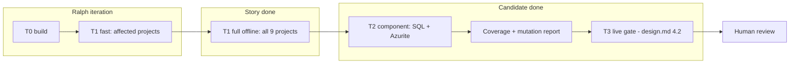
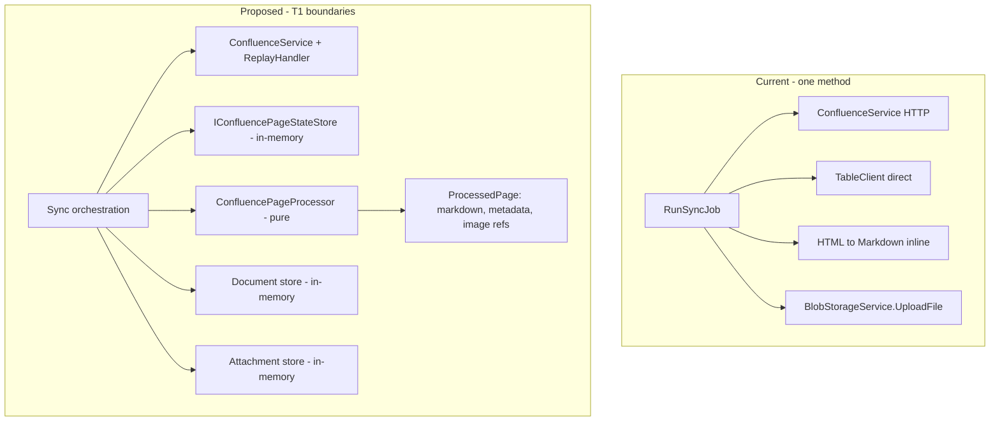

# Automated test approach for fast Ralph loops

**Status: Draft - for human review**

**Date:** 2026-10-19

**Feature ID:** `cuttle-development-test-loops`. This document is the practical companion to the [options design](design.md). The design compares options and defines the live integration gate. This document tells a developer or a Ralph iteration what to test, where, and with which command.

**Primary use:** Confluence images development, Stage A of the "Support images in content" Cuttle intent (`39a0be03-276e-47ee-875f-38006b90c52c`, status `planned`, design not yet reviewed).

**Secondary use:** the same approach applies to hardening the existing content-image feature on `feature/content-image-indexing-poc` ([design](../content-image-indexing-iteration-1/design.md), [manual test plan](../content-image-indexing-iteration-1/testing.md)). See [section 9](#9-applying-the-approach-to-option-1).

**Inspected revision:** API `feature/content-image-indexing-poc` at `74f900b25082ca6205888db375f9fba276025cd3`. Evidence is code and configuration inspection only. No tests, builds, sync jobs, or model calls ran while writing this document.

All script names, project names, trait names, and fixture paths in this document are **proposals** unless a section marks them as verified.

---

## 1. Problem and outcome

A Ralph iteration is a fresh agent session that implements one story, runs tests, commits, and exits. It needs a test result in seconds to minutes. A change to Confluence page processing today becomes visible only after this chain completes:

```
Confluence REST → sync job → Blob + Table → Search indexer (30-minute schedule) → skills → index → API retrieval → chat
```

That chain needs real Confluence credentials, real Azure Search, model quota, and up to 30 minutes of waiting. It cannot run per iteration.

**Before:** a developer changes how image attachments are found in page HTML. To see the effect, they run a sync against a real space, trigger the indexer, wait, and ask a chat question.

**After:** the developer runs `scripts/test/fast.sh`. A recorded Confluence response passes through the real HTTP parsing and the real page processing code. The test compares the produced Markdown, metadata, and image references with a checked-in expected file. The result is ready in under a minute. The full chain runs once, when the candidate is complete.

**Outcomes:**

| ID | Outcome | Measure |
| --- | --- | --- |
| O1 | Each Ralph iteration gets a test verdict without external services | Fast tier makes zero outbound network calls and loads no real credentials |
| O2 | Fast feedback | Fast tier under 60 s with warm build cache (proposed target, not measured) |
| O3 | Fakes stay honest | Each fake has a contract test that also runs against the real adapter (Azurite or the live gate) |
| O4 | Tests catch real defects | Mutation score on changed files is reported per candidate (see [section 8](#8-quality-guardrails)) |
| O5 | No false green | A candidate is not "done" until the full offline suite, the component tier, and the live gate pass for the same commit |

**Non-goals:** reproducing Azure Search ranking locally; replacing the live integration gate; defining Confluence image behavior (the Stage A design owns that); changing CI for existing tests.

---

## 2. Verified current state

| Fact | Evidence (code inspection unless stated) | Consequence for Ralph |
| --- | --- | --- |
| CI runs all 9 test projects | [test.sh](../../scripts/ci/test.sh) iterates `tests/*/*.csproj` (one directory level) | The full offline suite is the CI baseline. A project placed at `tests/component/<name>/` is **not** matched by this glob. |
| `mise run test` runs one project only | [mise.toml](../../mise.toml) `tasks.test` runs `AltusAiShared.Tests`. The [constitution](../../.specify/memory/constitution.md) section VII and [CLAUDE.md](../../CLAUDE.md) "Run tests" also name only that project. | A Ralph iteration that follows repo docs tests 1 of 9 projects. Documentation mismatch; fix with the proposed scripts. |
| All test projects use xUnit 2.9, Moq, Coverlet collector, net10.0 | `tests/*/*.csproj` | Coverage collection already works with `--collect:"XPlat Code Coverage"`. No new test framework is needed (constitution VII forbids inventing one). |
| This Windows host cannot build the repo yet | `global.json` requires SDK `10.0.302`. `C:\Program Files\dotnet\sdk` contains 8.0.426, 9.0.203, 9.0.205. `dotnet` and `docker` are not on the bash `PATH`; Docker Desktop is installed at `C:\Program Files\Docker`. Observed on 2026-10-19. | **P0 prerequisite.** Install SDK 10.0.302 and put `dotnet` and `docker` on the session `PATH` before any Ralph run. |
| Golden-file helper exists | [GoldenFile](../../tests/AltusAiAssistantApi.Tests/GoldenFile.cs) compares output with `Expected/*.txt`; `UPDATE_PROMPT_GOLDEN=1` rewrites them | Reuse the pattern for Markdown/metadata snapshots. |
| Embedded HTML fixtures exist | [TestHelpers.ReadEmbeddedResource](../../tests/AltusAiShared.Tests/TestHelpers.cs); `Resources/**/*.html` embedded in `AltusAiShared.Tests` | Extend to recorded JSON responses and small images. |
| Confluence HTTP is injectable | [ConfluenceService](../../AltusAiShared/Confluence/ConfluenceService.cs) constructor takes `HttpClient`; `GetContent` uses `/wiki/rest/api/content/{id}?expand=body.storage,ancestors` | A replay `HttpMessageHandler` exercises real URL building and JSON parsing. |
| Page processing is not callable alone | [ConfluenceSyncService.RunSyncJob](../../AltusAiShared/Confluence/ConfluenceSyncService.cs) fetches search results, queries Table state, fetches content, processes Grain links, converts HTML (`HtmlContentHelper.TransformHtmlTablesToText`, `ReverseMarkdown`), applies a 50-character minimum, uploads to Blob with `BlobMetadata.Create`, and upserts Table state in one method | **Main seam to add.** Without it, no fast test covers Confluence conversion end to end. |
| State and document stores exist, but not where sync needs them | [IConfluencePageStateStore](../../AltusAiConfluenceSync/IConfluencePageStateStore.cs) and [IConfluenceDocumentStore](../../AltusAiConfluenceSync/IConfluenceDocumentStore.cs) are in `AltusAiConfluenceSync` and are used by the ancestors and deleted-pages jobs. `RunSyncJob` lives in `AltusAiShared` and uses `TableClient` and `BlobStorageService` directly. | Move or mirror these interfaces into `AltusAiShared` so `RunSyncJob` can use them. |
| Table endpoint is hard-coded | [AzureTableClientHelper.InitializeTableClient](../../AltusAiShared/Confluence/AzureTableClientHelper.cs) builds `https://{account}.table.core.windows.net` | Azurite cannot back sync state until the client or endpoint is injectable. Five callers. |
| Job orchestration has a harness | [ConfluenceJobHarness](../../tests/AltusAiConfluenceSync.Tests/ConfluenceJobHarness.cs) | Reuse for job-level outcomes (partial failure, counters). It replaces the whole sync service, so it does not cover conversion. |
| Image pipeline has in-memory fakes | [ContentImageTests](../../tests/AltusAiShared.Tests/ContentImageTests.cs) defines fake `IContentImageCache`, `IContentImageStorage`, `IContentImageModel` (interfaces in [ContentImageDescriber.cs](../../AltusAiShared/ContentImages/ContentImageDescriber.cs)) | Promote these fakes to a shared test-support location instead of copying them. |
| Skill handler is callable without HTTP | [DescribeImagesTests](../../tests/AltusAiIndexerSkills.Tests/DescribeImagesTests.cs) calls `DescribeImages.Process` with `ImageSkillRecord` values | Recorded Search skill request bodies can be replayed directly into `Process`. |
| Index configuration is buildable offline | [ContentImageIndexingTests](../../tests/AltusAiAssistantApi.Tests/ContentImageIndexingTests.cs) calls `BuildSkillset` and the static `IndexingService.BuildIndexer` | Snapshot the produced skillset/indexer/index definitions as golden JSON. |
| Retrieval is mockable for chat | [ContentImageChatTests](../../tests/AltusAiAssistantApi.Tests/ContentImageChatTests.cs) mocks `IKnowledgeRetriever` and `IChatClient` | Feed recorded image-chunk search results to test citations in both chat modes. |
| Some Search callers bypass interfaces | `new SearchClient(...)` in `KnowledgeRetriever`, `AnaSearchService`, `DescriptionGenerationService`, `IdentityMentionsService`; `new SearchIndexClient(...)` in `IndexingService` | API host-level tests must replace all of them, or they can reach real Search. |

---

## 3. Test tiers



| Tier | Runs when | Real | Fake | External network | Proposed command | Proposed target |
| --- | --- | --- | --- | --- | --- | --- |
| **T0 build** | Each iteration, first | Compiler, analyzers | — | None after restore | `dotnet build AltusAiAssistantApi.sln --no-restore` | < 30 s warm |
| **T1 fast** | Each iteration | Parsing, conversion, image logic, skill handler, index definitions, prompt/citation composition | Confluence HTTP (replay), model, Search results, Blob/Table (in-memory) | **Forbidden** | `scripts/test/fast.sh` (affected projects) | < 60 s warm |
| **T1 full offline** | Before a story flips `passes=true` | Same as T1 | Same as T1 | Forbidden | `scripts/test/fast.sh --all` (all `tests/*/*.csproj`, same as CI) | < 3 min warm |
| **T2 component** | Once per candidate, and on stories that touch storage adapters | Azurite Blob/Table, SQL Server container, EF migrations, adapter code | Confluence (replay), Search, models | Local containers only | `scripts/test/component.sh` | < 5 min after containers ready |
| **T3 live** | Once per finished candidate; not inside Ralph | Everything | Nothing | Allowlisted test resources | Defined in [design.md section 4.2](design.md#42-live-integration-gate) | 10–30 min |

**Rule:** a Ralph iteration runs T0 and T1. It runs T1 full before flipping a story. T2 and T3 belong to the candidate gate, outside the Ralph loop. Ralph never holds live credentials.

---

## 4. Seams for Confluence images (Stage A)

Stage A adds Confluence JPEG/PNG attachments, including images displayed in pages, to the existing image pipeline. Its exact behavior is not designed yet. The seams below are needed whatever that design decides.

### 4.1 Current and proposed testable flow



### 4.2 Seam list

| # | Seam | Today | Proposed change | Unlocks |
| --- | --- | --- | --- | --- |
| S1 | Confluence HTTP replay | `ConfluenceService(HttpClient)` | Add test-only `ReplayHttpHandler` that maps `METHOD path?query` to recorded files. Unknown requests throw with the full URL. Asserts expected request count. | T1 for search pagination, content fetch, attachment listing and download |
| S2 | Page processor | Inline in `RunSyncJob` | Extract `ConfluencePageProcessor.Process(pageContent, attachments, settings) → ProcessedPage`. No I/O. Covers table transform, Markdown conversion, trivial-content threshold, metadata, and (Stage A) image-reference extraction. | Golden tests per fixture page |
| S3 | Page state | `TableClient` via `AzureTableClientHelper` | Move `IConfluencePageStateStore` to `AltusAiShared`; `RunSyncJob` uses it. In-memory fake for T1; Azure Table adapter for T2. | Incremental skip, pipeline-version resync, rename detection at T1 |
| S4 | Document writes | `BlobStorageService.UploadFile` | Extend `IConfluenceDocumentStore` with upsert keyed by client + page ID. Fake records path, content, metadata. | Assert exact blob path/metadata contract that the indexer reads |
| S5 | Attachment bytes (new in Stage A) | Not implemented | Attachment download goes through `ConfluenceService` (covered by S1). Storing image bytes goes through an interface with an in-memory fake. | Size limits, MIME filtering, dedupe by hash, ownership |
| S6 | Table endpoint | Hard-coded cloud URL | Inject `TableServiceClient` (or endpoint) into `AzureTableClientHelper` callers | Azurite at T2 |
| S7 | Image description | `IContentImageModel` | Reuse existing fakes, moved into shared test support | Description, cache reuse, tenant isolation at T1 |
| S8 | Search skill contract | `DescribeImages.Process` | Recorded skill request bodies (shape Search sends for an image-only source document) replayed into `Process` | Envelope parsing, per-record errors, exclusions |
| S9 | Index definitions | `BuildSkillset`, `BuildIndexer` | Golden JSON snapshots of the generated index, skillset, and indexer | Unreviewed index/skillset drift fails T1 |
| S10 | Retrieval and citations | `IKnowledgeRetriever` mock | Fixture search results containing image chunks with parent-page URLs; run both chat modes | Correct citation, reload persistence, client filter |
| S11 | Search client construction | `new SearchClient` in 4 services | `ISearchClientFactory` registered in DI; test host registers a fake that throws on use | API host tests cannot reach real Search |
| S12 | Time | `DateTime.UtcNow` in `RunSyncJob` | Inject `TimeProvider` | Deterministic incremental windows |

Add each seam in the story that first needs it. Do not front-load all twelve. Each seam change keeps production behavior identical; T1 full must stay green before and after the extraction.

### 4.3 Representative T1 cases for Stage A

| Case | Fixture | Assertion |
| --- | --- | --- |
| Page with one inline PNG | `page-inline-png` | Markdown contains the image marker at the right position; one image reference with the parent page URL and attachment ID |
| Attachment not displayed in page | `page-attachment-only` | Behavior matches the Stage A design decision (indexed or skipped) |
| JPEG and PNG accepted; GIF/SVG rejected | `page-mixed-formats` | Only JPEG/PNG references produced; rejection counted |
| Same image on two pages | `two-pages-same-image` | One model call (cache), two ownership records |
| Same image, two clients | `two-clients-same-image` | Two model calls; no cross-client cache hit |
| Attachment over size limit | `page-oversized-image` | Skipped with reason; page text still synced |
| Paginated attachment list | `page-many-attachments` | All pages of results followed; request count asserted |
| Page renamed | `page-renamed` (two versions) | Old document removed, new written, image ownership moved |
| Page deleted | `page-deleted` | Document and image ownership removed |
| Confluence 429 with `Retry-After` | `throttled-attachment` | Bounded retry, then visible failure; no hang |
| Malformed attachment JSON | `bad-attachment-payload` | Page fails visibly; other pages continue; counters correct |
| Instruction-like text in image description | `hostile-description` | Treated as content; does not alter prompt structure (golden prompt) |

---

## 5. Fixtures

### 5.1 Layout (proposed)

```
tests/Fixtures/confluence/
  page-inline-png/
    case.json                       # manifest
    requests/
      GET_wiki_rest_api_search.json
      GET_wiki_rest_api_content_1001.json
      GET_wiki_rest_api_content_1001_child_attachment.json
      GET_download_attachments_1001_diagram.png.bin
    expected/
      page-1001.md                  # golden Markdown
      page-1001.metadata.json       # golden blob metadata
      images.json                   # golden image references
```

### 5.2 Manifest

```json
{
  "id": "page-inline-png",
  "description": "One page with one inline PNG diagram",
  "client": "11111111-1111-1111-1111-111111111111",
  "spaceKey": "TST",
  "requests": [
    { "method": "GET", "path": "/wiki/rest/api/content/1001", "query": "expand=body.storage,ancestors", "file": "requests/GET_wiki_rest_api_content_1001.json", "status": 200 }
  ],
  "modelResponses": { "sha256-prefix-of-diagram": { "kind": "diagram", "description": "Service A sends orders to Service B." } },
  "expectedRequestCount": 4
}
```

### 5.3 Rules

- **Synthetic only.** Fixtures are invented content or explicitly non-sensitive pilot data. No production exports, tokens, cookies, account IDs, or SAS query strings. The intent requires this too.
- **Small images.** Keep each image under 50 KiB. Generate them with a script, so they are reproducible.
- **Strict replay.** An unmatched request fails the test with the URL. The replay handler never forwards to the network.
- **Recording is a human step.** A proposed `scripts/test/record-confluence.py` captures responses from the dedicated test space, strips auth headers and personal fields, and writes the files above. Ralph never records. Ralph may hand-write fixtures for edge cases that the real API cannot easily produce (429, malformed JSON).
- **Golden updates are deliberate.** Reuse the `GoldenFile` pattern with a new variable, for example `UPDATE_GOLDEN=1`. A commit that changes an `expected/` file must say why in the commit message. A reviewer checks every golden diff.
- **Re-record when the API changes.** Record the Confluence API version and recording date in `case.json`. A nightly live run (design section 6) detects drift; fix by re-recording, not by editing expectations by hand.

---

## 6. Commands and environment

### 6.1 Prerequisites (P0 for this host)

| Item | Required | Observed 2026-10-19 |
| --- | --- | --- |
| .NET SDK | 10.0.302 or a later 10.0.3xx (`global.json`, `rollForward: latestFeature`) | Missing; 8.0 and 9.0 only |
| `dotnet` on session `PATH` | Yes | No |
| Docker for T2 | Docker Desktop running, `docker` on `PATH` | Installed, not on `PATH` |
| Warm NuGet cache | Run one `dotnet restore` before the Ralph run | Unknown |

Without the SDK, a fallback is to run tests in `mcr.microsoft.com/dotnet/sdk:10.0` with a mounted NuGet cache volume. That adds container start time to every iteration. Prefer installing the SDK.

### 6.2 Proposed `scripts/test/fast.sh`

Behavior:

1. Build the solution once with `--no-restore`. Fail fast on errors.
2. Select test projects from changed files (`git diff --name-only <base>...HEAD` plus uncommitted changes) using the map below. `--all` selects every `tests/*/*.csproj`.
3. Run `dotnet test <project> --no-build --filter "Category!=Component&Category!=Live"`.
4. Unset or blank known credential variables (`Settings__SearchServiceKey`, `Settings__GptDeployments__*`, `Settings__BlobAccessKey`, Confluence tokens) before running.
5. Write a one-line summary and a JSON result (`TestResults/fast-result.json`: commit, projects, passed/failed counts, duration). Exit nonzero on any failure or if zero tests ran.

| Changed path | Test projects |
| --- | --- |
| `AltusAiShared/Confluence/**` | `AltusAiShared.Tests`, `AltusAiConfluenceSync.Tests` |
| `AltusAiShared/ContentImages/**` | `AltusAiShared.Tests`, `AltusAiIndexerSkills.Tests`, `AltusAiAssistantApi.Tests` |
| `AltusAiShared/**` (other) | All (shared code has many consumers) |
| `AltusAiConfluenceSync/**` | `AltusAiConfluenceSync.Tests` |
| `AltusAiIndexerSkills/**` | `AltusAiIndexerSkills.Tests` |
| `AltusAiAssistantApi/**` | `AltusAiAssistantApi.Tests` |
| `tests/Fixtures/**` | Projects that reference the fixture folder |
| Anything else, or unknown | All |

The map is an optimization only. T1 full (`--all`) before each story flip catches a wrong map.

### 6.3 Proposed `scripts/test/component.sh`

- Starts run-owned Azurite and SQL Server containers on random ports with names that include a run ID. Never reuses the `altus-ai-local` compose project or fixed port 1433.
- Applies EF migrations to the throwaway database.
- Runs the component project with connection details passed as environment variables.
- Removes only its own containers in a `trap` on every exit path.

Place component tests in `tests/component/AltusAi.ComponentTests/`. The CI glob `tests/*/*.csproj` does not match it, so CI stays unchanged until a reviewed decision adds it. Tag tests with `[Trait("Category", "Component")]` as a second guard.

### 6.4 Network guard

Windows has no simple per-process network deny. Enforcement for T1 is therefore layered:

1. No credentials in the environment (step 4 above).
2. Strict replay handler for Confluence.
3. Fake `ISearchClientFactory` (S11) that throws on use.
4. A T1 test that boots the API test host and asserts that no registered `HttpClient` has a non-loopback base address without a replay handler.

Optional, for CI on Linux: run T1 in a container with `--network none` after restore. That gives a hard guarantee.

---

## 7. Ralph integration

### 7.1 Make the commands discoverable

The Ralph harness runs "tests if a test command is referenced in the project's CLAUDE.md or scripts". Today [CLAUDE.md](../../CLAUDE.md) names only `AltusAiShared.Tests`. Proposed handoff: update the repo `CLAUDE.md` Testing section and `mise.toml` `test` task to point at `scripts/test/fast.sh` and `--all`. This is a separate reviewed change, not part of this document.

### 7.2 Story template

```json
{
  "id": "story-3",
  "title": "Extract image references from Confluence page storage HTML",
  "dependsOn": ["story-2"],
  "acceptance_criteria": [
    "Fixtures page-inline-png and page-mixed-formats exist under tests/Fixtures/confluence/",
    "ConfluencePageProcessor returns image references matching expected/images.json for both fixtures",
    "GIF and SVG attachments produce no references and increment the rejected counter",
    "scripts/test/fast.sh exits 0 and runs > 0 tests in AltusAiShared.Tests",
    "scripts/test/fast.sh --all exits 0",
    "No file under expected/ changed except those named in this story"
  ],
  "passes": false
}
```

Rules for writing stories:

- **One behavior or one seam per story.** A seam extraction that keeps behavior identical is its own story, before the story that changes behavior.
- **Name the fixture and the expected file.** Acceptance criteria that point at files are checkable by the next iteration.
- **Name both commands.** `fast.sh` for the iteration, `fast.sh --all` before `passes=true`.
- **Forbid silent expectation edits.** List which golden files may change.

### 7.3 Iteration rules (add to the Ralph prompt or `progress.txt` header)

1. Run `scripts/test/fast.sh` before editing, to confirm a green start. If it is red, record that in `progress.txt` and fix or stop; do not build on red.
2. Write or update the test first when the story changes behavior. Confirm it fails for the expected reason.
3. Never delete, skip, or weaken an existing assertion to make a test pass. If an existing test looks wrong, record it in `progress.txt` and append a story.
4. Never call real Confluence, Search, Blob, or model endpoints. Never record fixtures.
5. Run `scripts/test/fast.sh --all` before setting `passes=true`. Paste the summary line into `progress.txt`.
6. Kill only processes and containers you started (shared host).

### 7.4 Pipeline shape

Use a Cuttle pipeline with a `ralph` node for the loop, then a `single` node that runs the candidate gate:

1. `scripts/test/fast.sh --all` (T1 full)
2. `scripts/test/component.sh` (T2)
3. Coverage and mutation report on changed files ([section 8](#8-quality-guardrails))
4. Verify the JSON results: same commit, nonzero tests, no failures.

The node reports `SUCCESS` only after step 4. The live gate (T3) stays a separate, human-started step until the open questions in [design.md section 10](design.md#10-human-review-questions-and-remaining-assumptions) are resolved.

---

## 8. Quality guardrails

Agents can produce many tests that execute code but assert little. Measure test strength, not only test count.

| Guardrail | How | When |
| --- | --- | --- |
| Branch coverage on changed files | `dotnet test --collect:"XPlat Code Coverage"` (Coverlet collector already referenced), then a report tool such as ReportGenerator filtered to changed files | Candidate gate |
| Mutation score on changed files | Stryker.NET (`dotnet stryker --since:<base>`), scoped to the changed project | Candidate gate; too slow for each iteration |
| Fails-before check | For a behavior story, the new test must fail on the parent commit | Reviewer, or a candidate-gate script that reverts source and reruns new tests |
| Assertion-free test scan | Grep new test methods for at least one `Assert.` call | Candidate gate |
| Golden diff review | Every `expected/` change is listed in the PR description | Human review |

**Assumption:** Stryker.NET supports the repo's .NET 10 / xUnit 2.9 setup. Verify on one project before relying on it. Stryker is a test-quality tool, not a second test framework, so constitution VII does not forbid it. The team should still confirm that adding a dotnet tool manifest is acceptable (open question Q3).

Proposed initial thresholds, to calibrate after the first run: branch coverage ≥ 80% on changed lines; mutation score ≥ 60% on changed files. Do not gate on thresholds until a baseline exists.

---

## 9. Applying the approach to Option 1

Option 1 is "use Cuttle to reach good test coverage for the existing content-image feature". The same tiers, rules, and guardrails apply. Fewer seams are needed because the PoC already has most of them.

| Approach element | Option 2 (Confluence images) | Option 1 (existing PoC) |
| --- | --- | --- |
| Main fast seams | S1–S5, S12 must be added | S7–S10 already exist; S11 recommended |
| Fixtures | Recorded Confluence responses + images | Small PDF/DOCX/PPTX samples and recorded skill request bodies; image bytes |
| Golden files | Markdown, metadata, image references | Skill responses, index/skillset/indexer JSON, chat prompts with image markers |
| Story source | Stage A design (after review) | [testing.md](../content-image-indexing-iteration-1/testing.md) sections converted to automated checks, plus coverage/mutation gaps |
| T2 component | Azurite Table/Blob for sync state and images | Azurite for `ContentImageCache` (Table) and `ContentImageStorage` (Blob); SQL for the client opt-in migration |
| T3 live | Confluence → sync → Search → chat | Upload PDF → indexer → skill → chat (testing.md flow) |

**Baseline first.** Before the first Ralph story, record: test count per project, branch coverage and mutation score for `AltusAiShared/ContentImages/**`, `AltusAiIndexerSkills/**`, and the image-related API services. Without a baseline, Option 1 cannot show improvement.

**Characterization caution.** Tests written after the code tend to lock in current behavior, including bugs. When a Ralph iteration finds behavior that contradicts [the PoC design](../content-image-indexing-iteration-1/design.md) or testing.md:

1. Do not write a test that asserts the suspicious behavior.
2. Record it in `progress.txt` and in a findings list (proposed `specs/content-image-indexing-iteration-1/test-findings.md`) with the source reference.
3. Append a story to confirm with a human. Count it as a defect found in the evaluation.

Example first stories for Option 1:

1. Move the image fakes from `ContentImageTests` into shared test support; no behavior change; `fast.sh --all` green.
2. Golden snapshot of `BuildSkillset` and `BuildIndexer` output for images enabled and disabled.
3. Replay three recorded `DescribeImages` request bodies (PDF page image, DOCX embedded image, excluded path) through `Process`.
4. Opt-in rejected when `ContentImages__DescribeImagesSkillUri` is missing (testing.md section 1).
5. Skill host rejects all image requests when `Skills__Codes__DescribeImages` is not set.
6. Component test: `ContentImageCache` against Azurite Table (client isolation, `DeleteClient`).

---

## 10. What fast tests cannot prove

These need the live gate ([design.md section 4.2](design.md#42-live-integration-gate)). A fast or component pass never claims them:

- Azure Search document cracking and image normalization on real PDF/DOCX/images.
- Search calling the deployed skill over HTTPS, with real timeouts and retries.
- Real Confluence API behavior and permissions for attachments.
- Model description quality, and the intent's quality gates (≥ 80% correct-source retrieval, ≥ 70% correct answers on ≥ 20 image questions, per chat mode).
- The 120-minute freshness target for updates and deletions.
- Entra sign-in and browser citations after reload.

---

## 11. Acceptance criteria for this approach

None of these have been executed.

| ID | Criterion | Validation |
| --- | --- | --- |
| R1 | `fast.sh` runs with no credentials in the environment and exits 0 on the current branch | Run in a clean shell with only `PATH` set |
| R2 | A replay test with an unrecorded URL fails with that URL in the message | Unit test of `ReplayHttpHandler` |
| R3 | `fast.sh` exits nonzero when zero tests run | Run with a filter that matches nothing |
| R4 | `fast.sh` under 60 s and `--all` under 3 min with a warm cache, median of 10 runs on this host | Timing log |
| R5 | `component.sh` leaves no containers after success, failure, or Ctrl+C | Run three ways; `docker ps -a` filtered by run ID is empty |
| R6 | Each in-memory fake used at T1 has a contract test that also passes against Azurite | Shared contract test class run by both tiers |
| R7 | Extracting `ConfluencePageProcessor` changes no golden output for existing HTML fixtures | Golden tests pass before and after the extraction commit |
| R8 | A Ralph run of at least five stories completes with every story's `fast.sh --all` summary in `progress.txt` | Inspect the run artifacts |
| R9 | The candidate gate rejects a result from a different commit | Script test with a stale result file |

---

## 12. Open questions

| # | Priority | Question | Options | Recommendation | Blocks |
| --- | --- | --- | --- | --- | --- |
| Q1 | P0 | How will the Ralph host get .NET SDK 10? | Install on host; run tests in an SDK container | Install on host. Container per iteration adds startup time. | Any Ralph run on this host |
| Q2 | P1 | Where do the interfaces for S3/S4 live? | Move to `AltusAiShared`; keep in `AltusAiConfluenceSync` and move `RunSyncJob` there | Move interfaces to `AltusAiShared`; smaller change | First Confluence seam story |
| Q3 | P1 | May the repo add a dotnet tool manifest (Stryker, ReportGenerator)? | Yes, in repo; install per run; skip mutation testing | Yes, in repo, used only by the candidate gate | Guardrails in section 8 |
| Q4 | P1 | Should CI run the component tier? | Not yet; add a separate pipeline step with Docker service | Not yet. Add after it is stable locally. | CI changes only |
| Q5 | P2 | Who records Confluence fixtures, and from which space? | Developer from a dedicated test space; reuse a QA space | Dedicated test space, recorded by a person, reviewed in PR | Recorded (non-hand-written) Stage A fixtures |
| Q6 | P2 | Should `mise run test` and CLAUDE.md change to the new scripts? | Yes; keep as is | Yes, in the same PR that adds the scripts | Ralph discovering the right command |

This draft is for human review. It is not approval to change code, CI, or the Ralph configuration.
