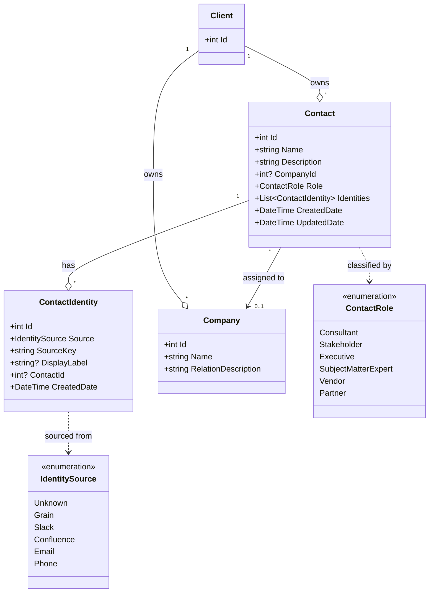

# Contacts Feature — Entity Model (Draft)

A first sketch of the entities behind the Contacts directory, distilled from the four Grain sessions and the options analysis in [contacts-proposal.md](contacts-proposal.md). Field-level detail deferred — the goal here is to agree on the shapes and the relationships between them.

## Entities

### Contact
The canonical person a user curates. Belongs to a client. Carries a display name, a description, a company, and a role (from the fixed `ContactRole` enum). Has many identities. This is what the LLM ultimately reasons about.

### ContactIdentity
A single observed identity from one source (a Grain participant ID, a Slack user ID, a Confluence author, an email, a phone-only attendee, or an entry with no known source). Each identity belongs to exactly one source and may or may not be linked to a Contact — *unassigned* is just an identity with no contact link. Identities carry no semantic content of their own; all display and role data lives on Contact. A user typing in an email or Slack handle by hand still gets the `Email` / `Slack` source — `Unknown` is reserved for identities that genuinely can't be attributed to one of the first-class sources.

### Company
A managed per-client pool. Carries a name and a relation description (*"Ops Pro is a vendor at CSSI doing AI engineering automation"*) — the relation description is what gives the model the framing it needs to interpret stakeholder vs. consultant vs. third party. Picked from a dropdown when assigning a company to a Contact to prevent fat-finger duplicates.

### ContactRole (enum)
A fixed enum of classifications (consultant, stakeholder, executive, SME, vendor, partner, …). Not a separate entity — values are defined in code and shared across all clients. Each Contact has exactly one role.

### Client (existing)
Owns the Contacts, Companies, and Identities directory. All curation is per-client; all users of a client see the same directory.

## Relationships



```
Client ──< Company
Client ──< Contact   (role: ContactRole enum)
            │
            └──< ContactIdentity   (contact link is optional — null = unassigned)
                       │
                       └── source ∈ { Grain, Slack, Confluence, Email, Phone, Unknown }
```

## Key Distinctions

- **Identity ≠ Contact.** Many identities collapse to one canonical contact. This was the central debate on 2026-04-30 and the reason a separate `ContactIdentity` entity exists rather than a list of strings on `Contact`.
- **No "primary" identity.** Identities are just source-system pointers (a Slack user ID, a Confluence author, an email) used to bind ingested content back to the Contact. None of them is meaningfully canonical — the Contact itself carries the display name. The "main contact" framing from 2026-05-07 was a residue of an earlier model where multiple full Contact records were linked together; under the current model it has nothing to point at.
- **Unassigned is a state, not a separate entity.** An identity without a contact link is what populates the "unassigned identities" panel.
- **Companies are per-client.** Within one client (e.g., CSSI) there are many companies (CSSI, Ops Pro, Aligned Capital Partners, Altus Nova, …).
- **Mirrors Taxonomy.** Same per-client ownership pattern as the existing Taxonomy entity, same render-into-prompt mechanism at chat time.
- **No index dependency.** The directory is read at chat time only — edits take effect on the next chat call without reprocessing ingested content.

## Open Shape Questions

- Whether `ContactIdentity` needs a persisted "suggested contact" link for auto-grouping hints, or whether that's computed on demand.
- Whether Company should be global or stay per-client (current assumption: per-client).
- Whether merging two existing Contacts is a first-class operation or just an identity-reparenting flow.