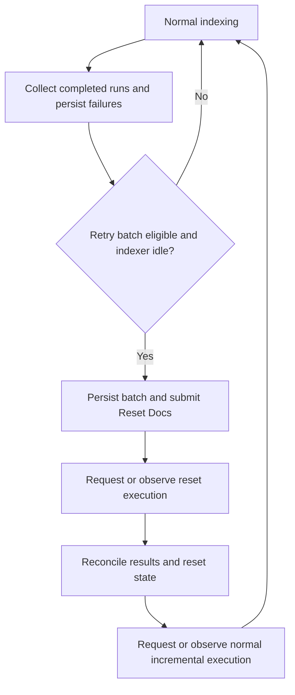

# Indexer Skip Metadata and Failed-Document Retry with Reset Docs

_Created: 2026-08-26. Revised: 2026-09-07._
_Status: proposed retry implementation; skip-metadata work completed per the current investigation._
_Background: [Monet indexer failure analysis](../indexing-analysis/Monet/analysis.md), especially §3.2 and §4._

## Goal and decision

Keep normal indexing tolerant of document failures with `maxFailedItems: -1` and `maxFailedItemsPerBatch: -1`. Add a worker that collects failures, tracks a bounded retry budget per blob ETag, and submits eligible source documents through Azure AI Search **Reset Docs**.

Retries do not modify blob contents, metadata, ETags, or `Last-Modified`. Retry counts and scheduling state live in durable storage. Normal incremental indexing must receive an opportunity to progress between retry batches.

This design selects Reset Docs for implementation, subject to the integration checks in Part 4. The API is preview and a reset phase delays ordinary ingestion on the affected indexer. Its duration and behavior with permanently failing documents must be measured before enabling automatic retries.

## Background

The Monet investigation found two source documents whose projection writes failed with HTTP 503 and which were not recovered by later normal runs. Failure tolerance let other documents progress but did not provide the desired bounded recovery policy.

The previous experiment with `maxFailedItems: 0` had the opposite problem: a deliberately failing stub was retried on the next scheduled run, while an unrelated changed file was not processed until the stub was repaired. That observed blocking is the reason to retain both `-1` settings. These settings do not prevent service-level failures or timeouts; those still need monitoring.

The intentionally excluded files are already handled through skip metadata. The remaining work is recovery of genuine document failures without changing the indexer's failure thresholds.

## Part 1 — Preserve the completed skip-metadata behavior

The blob indexer supports `AzureSearch_Skip = true` to exclude a blob entirely. `AzureSearch_SkipContent` would still index metadata and is not the mechanism used here. See [Azure Blob indexer](https://learn.microsoft.com/en-us/azure/search/search-how-to-index-azure-blob-storage).

| Source | Existing behavior to preserve |
|---|---|
| `emptyfilestub.txt` | `BlobStorageService.CreateFolder` stamps `AzureSearch_Skip` when creating folder stubs. |
| `__private__/{sessionId}/*` | `ChatService` supplies destination metadata when creating a private copy, retaining source metadata and adding `AzureSearch_Skip`. |
| Other copies and moves | `BlobStorageService.CopyFile` retains its optional metadata argument and existing inheritance behavior. |
| Private-folder skill check | Retain the independent private-path rejection as a backstop. A failure here requires attention, not retry. |

Relevant source: [BlobMetadata.cs](../altus-ai-assistant/AltusAiShared/BlobMetadata.cs), [BlobStorageService.cs](../altus-ai-assistant/AltusAiShared/BlobStorageService.cs), and [ChatService.cs](../altus-ai-assistant/AltusAiAssistantApi/Services/ChatService.cs).

The existing [skip-metadata backfill script](../altus-ai-assistant/scripts/backfill-search-skip-metadata.ps1) remains an operator tool for repairing older blobs. It preserves the full metadata collection because Set Blob Metadata replaces it. The retry worker never performs this write.

Skip flags are not proof that previously indexed content has been removed. If a future incident exposes private content in the shared index, investigate and clean up the index separately. Never clear a skip flag to make a retry succeed.

## Part 2 — Reset Docs contract

### 2.1 Selection followed by execution

Reset Docs selects documents for re-ingestion; it does not execute the indexer. A scheduled or on-demand run processes that selection, including skillset processing. Normal incremental processing resumes on a subsequent run from the retained normal change-tracking position. Selected documents are processed even if the source contents have not changed. This is distinct from resetting the entire indexer.

The preview status response exposes `currentState.mode`: `indexingResetDocs` during selective processing, and `indexingAllDocs` for ordinary processing. Invalid or nonexistent keys can be ignored, so an accepted request and an error-free run do not prove the intended files were indexed. See [Run or reset indexers](https://learn.microsoft.com/en-us/azure/search/search-howto-run-reset-indexers#how-to-reset-docs-preview).



### 2.2 API requests and identifiers

Initially pin reset and status calls to `2025-11-01-preview`, the version referenced by this design. Validate it against the deployed service in Part 4; do not silently switch preview versions. Run calls may use the existing supported API version.

```http
POST https://{service}.search.windows.net/indexers('{indexer}')/search.resetdocs?api-version=2025-11-01-preview&overwrite=true
Content-Type: application/json

{
  "datasourceDocumentIds": [
    "<validated source identifier for failed blob A>",
    "<validated source identifier for failed blob B>"
  ]
}
```

The body accepts either `datasourceDocumentIds` or `documentKeys`. For this chunked pipeline, use **source document identifiers** once their exact format has been validated. A file can fail before any searchable chunk exists; deriving retry targets by querying successful chunk keys would miss such files.

`overwrite` is a **query parameter** in this API version. `true` replaces the pending selection; `false` appends. A `204` response acknowledges selection only. The worker replaces only its own recorded batch, never another operator's pending selection. See the [Reset Docs REST contract](https://learn.microsoft.com/en-us/rest/api/searchservice/indexers/reset-docs?view=rest-searchservice-2025-11-01-preview).

Follow selection with Run and poll Status:

```http
POST https://{service}.search.windows.net/indexers('{indexer}')/search.run?api-version=2025-11-01-preview

GET https://{service}.search.windows.net/indexers('{indexer}')/search.status?api-version=2025-11-01-preview
```

After reset processing completes, request or observe a normal run before submitting another batch.

### 2.3 Scheduling and performance limits

Each indexer is single-instance. Ordinary changes wait during its reset phase. Documentation warns of source scanning and document cracking when locating reset document keys. It does not establish a direct-lookup guarantee for `datasourceDocumentIds`; measure source-ID behavior rather than assuming it scans everything or only fetches selected blobs. See [reset-state guidance](https://learn.microsoft.com/en-us/azure/search/search-howto-run-reset-indexers#check-reset-status-currentstate).

Treat this as a delay on the affected indexer, not a documented global lock on all indexers. Shared capacity can still affect other workloads.

Use small batches, a per-service concurrency limit, and a normal run between batches. A watchdog can stop admitting retries and request removal of a pending reset selection, but cannot promise to cancel an already executing indexer job immediately. Alert when normal ingestion does not resume within the operational deadline.

## Part 3 — Retry worker

### 3.1 Host, ownership, and access

Implement `AltusAiIndexerRetry` as a console job using the backend's existing worker conventions, with an environment-specific scheduler such as a Kubernetes CronJob. Do not assume existing sync workers are timer-triggered Functions. Each invocation reconciles state and exits instead of waiting inside a process for a long indexer execution.

Enumerate enabled clients from the database. Resolve the configured Search service and storage account, client indexer (`{UniqueId}-indexer`), and source container. Verify the indexer's data source agrees with the configured client mapping before submitting identifiers.

Use existing managed-identity or secret configuration for Search, read-only blob access, and read/write retry-state access. The worker needs no blob write permission. Do not recreate indexes, data sources, or skillsets during retries; the analysis records deployed configuration drift that must be handled independently.

Acquire a renewable lease per Search service/indexer before orchestration decisions. Use optimistic concurrency for state updates and one shared protocol for automation and manual tools. A process lock or CronJob overlap policy alone does not coordinate multiple hosts and operators.

### 3.2 Collect every retained completed execution

Read all unseen **completed** entries in `executionHistory`, oldest first, including successful runs with document errors. Use an execution identity composed of service, indexer, start time, and end time. Persist observations idempotently before advancing the checkpoint. Do not use only `lastResult` or treat top-level `status: running` as proof of active execution.

The history retains up to 50 recent runs. Detect when the previous checkpoint falls outside retained history and report a coverage gap. The short continuation runs in Monet make this necessary even with frequent polling. See [monitoring indexer status](https://learn.microsoft.com/en-us/azure/search/search-monitor-indexers).

Preserve run totals, errors, warnings, top-level failure, and reset context when available. Multiple errors for one source blob in an execution produce one failure observation with all diagnostic details attached. Retain raw keys for investigation, excluding credentials or SAS tokens from logs.

Diagnostic lists are not assumed to be a complete failure queue. Compare failed-item totals with explainable source failures, allowing for chunk fan-out and repeated error rows. Flag capped or unexplained results and unresolved keys. Monet demonstrates capped warning exports; establish actual error-list limits rather than assuming both limits are identical.

### 3.3 Resolve source identity and classify failures

Observed error keys can have a composite form:

```text
localId=https%3a%2f%2f...%2fBank%2520Training%2520Docs%2ffile.pdf&documentKey=...
```

Parse the outer structure, retain the source locator, and decode each layer only as its format requires. Do not blindly unescape the entire string twice: literal percent sequences, encoded separators, and query parsing can change a valid blob name. Keep separate canonical blob identity and API identifier fields. Validate both against real fixtures and Search; chunk keys, bare filenames, and composite error keys are not interchangeable.

| Failure or source state | Action |
|---|---|
| `AzureSearch_Skip`, private path, or stub | Exclude from retry; alert on unexpected indexing or missing skip metadata. |
| Transient document failure, including throttling, timeout, or unavailable projection destination | Queue with backoff. |
| Unknown document error with a resolvable source | Queue within the finite budget; retain diagnostics. |
| Recognized permanent content/format problem | Mark `NeedsAttention`; permit explicit retry after repair. |
| Widespread authentication or configuration failure | Pause new retries for the affected indexer and alert. |
| Run failure without source keys | Record a run-level incident; do not reset speculative blobs. |
| Deleted source | Mark `SourceGone`; index deletion cleanup is separate. |
| Unresolvable or out-of-client identifier | Do not submit; record a coverage/configuration incident. |

Classify using stage and details as well as HTTP status: a custom-skill wrapper can obscure the cause. Text truncation warnings need separate remediation and are not automatically retried.

### 3.4 Blob ETag and renewal of the budget

Use **ETag**, rather than `Last-Modified`, as the source revision identifier. Azure supplies it as an opaque concurrency token, so compare it for equality without parsing or ordering it. This avoids depending on timestamp precision to distinguish updates. Keep `Last-Modified` only for diagnostics and identifying source changes that clearly postdate a failed execution. See [Azure Blob optimistic concurrency](https://learn.microsoft.com/en-us/azure/storage/blobs/concurrency-manage#optimistic-concurrency).

The budget belongs to the canonical blob identity and its observed ETag. In this document, a generation means this blob revision, with an optional operator renewal recorded separately. Reset Docs does not write the blob, so repeated reset attempts retain the same ETag and budget. Read blob properties when collecting a failure and before dispatch; no MD5, content download, hash calculation, or uploader changes are required.

| Observation | Budget behavior |
|---|---|
| Same ETag, including repeated Reset Docs calls | Retain retries issued and backoff. |
| Changed ETag after a content upload | Supersede the prior generation; the new revision gets a fresh budget. |
| Changed ETag after a metadata/property update or identical-content reupload | Also renew the budget. This deliberately permits retries after metadata repairs. |
| Properties cannot be read | Defer and report the read failure; do not invent a new revision or reset the budget. |

This policy renews retries on external blob revisions, not exclusively on byte changes. A producer repeatedly rewriting unchanged blobs can therefore renew the budget repeatedly; the limit is per revision, not per path forever. Keep service-wide batch limits and backoff in place, and expose repeated renewals operationally.

If the ETag changes before dispatch, supersede the old record and let normal change detection process the new revision first. Do not charge a stale failure to the new ETag. The properties observed after a run do not prove which revision Search read: where execution-to-revision attribution cannot be established, retain uncertainty. Recheck ETag during outcome reconciliation; Reset Docs does not accept an ETag condition or pin an immutable source revision.

Periodically recheck exhausted records so updated blobs can regain a budget. A manual force operation also permits renewal after a skillset/configuration repair with unchanged ETag, recording the reason and operator.

### 3.5 Durable state

Use Azure Table Storage in the account used for worker state, following existing concurrency conventions. A database implementation with equivalent guarantees is acceptable. State is authoritative; no `indexRetryCount` blob metadata is written.

| Record | Required fields |
|---|---|
| Indexer coordinator | Service/indexer/client identity, execution checkpoint, lease, pause reason, active batch, phase, last normal execution, recovery deadline. |
| Document generation | Canonical account/container/path, validated source identifier, generation ID, source ETag, observed `Last-Modified`/read time, optional operator-renewal reason, retries issued, next eligibility time, state, last failure execution and diagnostics. |
| Reset batch | Batch ID, selected generations, creation time, durable dispatch intent, acknowledgement state, observed executions, phase, deadline, reconciliation outcome. |
| Execution observation | Deduplication identity, totals, bounded diagnostics, resolved source failures, completeness assessment. |

Include service and indexer in the key namespace. Use a collision-resistant hash of canonical blob identity for a Table row key and retain the original identity in columns; lossy path sanitization can conflate files.

Document states include `Pending`, `Submitted`, `AwaitingVerification`, `Recovered`, `Exhausted`, `NeedsAttention`, `Superseded`, and `SourceGone`. Retain generation budgets after recovery; disappearance from an error list does not delete state or replenish attempts.

### 3.6 Dispatch, restart recovery, and fairness

1. Acquire the indexer lease, collect observations, and reconcile any active batch before choosing new work.
2. Require no active execution, ordinary indexing mode, and no unexplained pending selection. Pause rather than replacing another operation's work. Recheck on conflicts: the Azure schedule can race with the worker.
3. Select due documents up to the limit. Refresh source identity, generation, and skip status. Persist an immutable batch and dispatch intent before the Search request.
4. Submit Reset Docs. Charge one retry per document for an acknowledged logical dispatch, not per poll, transport retry, skill error, or continuation run. If the response is lost, mark dispatch ambiguous and reconcile it before further submission.
5. Request Run if no execution started. A scheduled run may consume the selection first; observe it instead of duplicating work. A conflict is a reconciliation event, not a failed document attempt.
6. On later invocations, inspect current reset state and completed executions. Preserve the batch across continuation runs. Do not append new failures or replenish its selection while running.
7. After the reset phase, reconcile outcomes and enter `NormalRunRequired`. Request or observe normal incremental execution before another batch. Prioritize ordinary processing if it fails or has a backlog of continuations.

Exactly-once execution is not assumed across Table Storage and Search. Use persisted intent, leases, and reconciliation to bound duplicates. Request IDs aid diagnostics but are not assumed to be idempotency keys. If history/state cannot determine whether dispatch ran, keep its reservation charged and mark `AwaitingVerification`; require reconciliation or explicit operator action rather than retrying indefinitely.

If a batch exceeds its operational deadline, stop admitting retries and alert. Once safe to coordinate the selection, clear only the worker-owned pending reset set using `overwrite=true` with an empty `datasourceDocumentIds` array, then observe/request normal processing. This abandons pending selective work; it does not immediately cancel an executing indexer job. Validate this path, including permanently failing documents, in Part 4.

### 3.7 Outcomes and exhaustion

Successful submission, return to ordinary mode, and absence from a later error list are separate observations. None alone proves recovery. Relate errors to the recorded batch and execution window, verify identifier matching, and retain ambiguity if the source ETag changed during processing or diagnostics are incomplete.

For an observed failed attempt, schedule another retry if budget remains. After the final allowed attempt has actually failed, mark `Exhausted` and emit an alertable event. Submitting the fifth attempt is not itself failure of that attempt.

A completed reset with no further observed failure initially moves the document to `AwaitingVerification`. Verify search output before calling it `Recovered`. This pipeline projects multiple chunks per blob: one matching chunk proves only partial progress, and a successful skill response does not prove the later index write succeeded. For documents with known expected chunks, compare complete output. General automated verification requires a generation marker and expected chunk count or equivalent manifest, a separate extension. Until available, retain `AwaitingVerification` and the budget; pending verification alone does not trigger another retry.

Report recovered, failed, and unverified documents separately. A changed source ETag or explicit operator renewal can create a fresh generation under §3.4.

### 3.8 Initial configuration and operational signals

These are proposed starting values to tune after the pilot, not Azure guarantees.

| Setting | Initial value | Purpose |
|---|---|---|
| `IndexerRetry:Enabled` | `false` | Controls new batch admission; active-state reconciliation continues when disabled. |
| Reconciliation interval | 2 minutes | Collect runs and resume ordinary indexing promptly. |
| `IndexerRetry:MaxRetryAttempts` | 5 | Additional logical reset attempts per source ETag, unless explicitly renewed by an operator. |
| `IndexerRetry:RetryDelays` | 30m, 2h, 8h, 24h, 48h | Eligibility delays after the preceding failure, with jitter. |
| `IndexerRetry:MaxBatchDocuments` | 10 | Bounds selection size; source scan time can still dominate. |
| `IndexerRetry:MaxConcurrentBatchesPerService` | 1 | Initial shared pressure limit. |
| `IndexerRetry:BatchDeadline` | 30 minutes | Escalation/stop-admission threshold, not hard cancellation. |
| Exhausted-source refresh interval | 24 hours | Detect source ETag changes without new failure rows. |
| Search preview version | `2025-11-01-preview` | Explicitly pinned and integration-tested contract. |

Emit metrics/events for pending retries, attempts, exhaustion, unverified outcomes, history/diagnostic gaps, active reset duration, age of the last normal run, and paused indexers. Route incidents through existing platform alerting; a silent log-only exhausted record does not satisfy the recovery objective.

### 3.9 Manual operation

Provide `scripts/retry-failed-index-documents.ps1` or an equivalent worker command accepting client IDs and optionally explicit source identities. It uses the same state, lease, and batch protocol. Dry run reports source identities, generations, prior attempts, exclusions, and planned Search calls without changes.

`-Force` requires a reason and records renewal after repair. It does not bypass skip/private checks, client validation, or active-operation ownership. Credentials use existing configuration. No retry command mutates blob metadata.

Support a resume-normal operation to reconcile and clear an owned pending selection. Never use a full indexer reset as a fallback for an unresolved key or ambiguous dispatch.

## Part 4 — Validation and rollout

### 4.1 Integration checks before enabling automation

Use a nonproduction indexer with representative container size and current chunk projections. These are acceptance checks, not claims of already verified behavior.

| Scenario | Required evidence |
|---|---|
| Two known failed blobs, including one with no indexed chunks | Correct source-ID encoding, intended sources processed, complete expected output recovered. |
| Spaces, percent signs, Unicode, nested folders | Stable canonical identity and exact matching without double-decoding errors. |
| Large container with a small reset batch | Reset duration, source enumeration/read activity, unrelated ingestion delay, and acceptable operational budget. |
| Unrelated file changed during reset | Subsequent normal run processes it; repeated batches do not starve ingestion. |
| Permanently failing source with both limits at `-1` | Reset-list lifecycle, continuation behavior, exhaustion, and restoration of normal processing via empty selection. |
| Restart before/after Reset Docs or Run acknowledgement | No lost batch, uncontrolled duplicate dispatch, or repeatedly charged polling cycle. |
| Schedule race or another operator's selection | Reconciliation without overwriting foreign work. |
| Repeated resets, content upload, identical reupload, metadata/property update | Resets retain the ETag and budget; every changed ETag receives a fresh budget. No content download or MD5 dependency. |
| ETag change before dispatch or during reset; failed properties read | Stale failures are not charged to a new revision; ambiguous outcomes remain unverified; read failures do not renew the budget. |
| Invalid/deleted source, partial projection, diagnostic gap | No false recovery; explicit source-gone, unverified, or coverage-gap state. |

Pay particular attention to whether a tolerated failure remains in the reset selection. Do not assume either success or permanent retention from acknowledgement. Record tested behavior against the chosen API version.

### 4.2 Rollout sequence

1. Confirm completed skip behavior and client-to-indexer/data-source mapping. Do not repeat completed skip backfills as a retry rollout step.
2. Validate identifiers and API behavior with a manual dry run, then execute integration checks in the chosen test environment.
3. Implement durable state, collection, and reconciliation. Deploy with admission disabled; inspect failures and coverage gaps.
4. Enable one client conservatively. Verify normal-run progress, outcomes, unchanged source properties, and the disable/resume-normal path.
5. Expand after scan duration and ingestion latency are acceptable. Keep control to stop new retries without abandoning an active reset phase.

If the pilot cannot meet ingestion latency or reliably select sources, revisit the transport choice. Metadata bumps remain an alternative requiring a separate design decision; do not silently switch mechanisms on API errors.

## Part 5 — Boundaries

- This is bounded recovery of observed document errors. Status retention and diagnostic limits prevent a guarantee that every lost document is found. End-to-end inventory reconciliation is separate work.
- General chunk-completeness manifests and generation projection fields are a follow-up for automated verification. Initial reporting must expose unverified outcomes.
- Deterministic truncation, admin upload format validation, embedding capacity, and Search/skillset configuration drift remain independent tasks.
- Skillset/configuration repairs can justify operator renewal without changing the source ETag. Automatic revision-based renewal alone does not handle them.
- This document defines intended implementation. It does not deploy a worker, modify failure thresholds, update blob properties, or invoke Search reset/run APIs.
