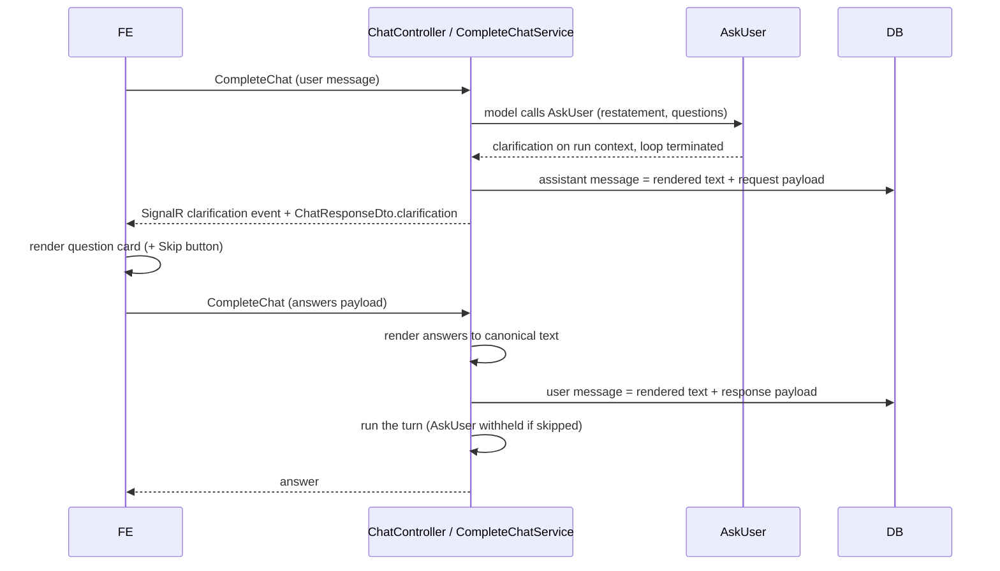

# Structured clarification questions

**Status:** Proposed high-level design (drafted 2026-09-23)

**Scope:** primary backend ([altus-ai-assistant](../altus-ai-assistant/)) and primary frontend ([altus-ai-assistant-fe](../altus-ai-assistant-fe/)). The voice stack is out of scope.

## Purpose

When the assistant needs clarification it calls [AskUser](../altus-ai-assistant/AltusAiAssistantApi/Services/Maf/AskUserTool.cs), which already receives a *structured* payload — a restatement plus a list of questions. The host immediately flattens that payload into markdown ([`ClarifyRequest.ToMarkdown`](../altus-ai-assistant/AltusAiAssistantApi/Services/Maf/AgenticWorkflowTypes.cs)) and persists it as an ordinary assistant message, so the frontend receives an opaque blob of text.

Two consequences:

- The FE cannot render questions as a form — no per-question controls, no suggested answers, no validation that every question was addressed.
- The "just continue without further clarification" escape hatch is currently modelled as a *fourth question* the model is prompted to invent ([ambiguity.prompt](../altus-ai-assistant/AltusAiAssistantApi/Prompts/sections/ambiguity.prompt)). It is a UI affordance wearing a question's clothes: its wording drifts run to run, and the user answers it by typing prose.

This design keeps the clarification payload structured all the way from the tool call to the rendered UI and back, so the FE can present a proper question card and the skip action becomes a button.

## Guiding principles

1. **Structure travels; text remains the source of truth for the model.** The model always produced and always consumes plain text. The structured payload is an additional, parallel representation used for display and input collection. The rendered text stays on the message so history building ([`ChatTurnStore.BuildHistory`](../altus-ai-assistant/AltusAiAssistantApi/Services/Maf/ChatTurnStore.cs)) and the prompt contract are untouched.
2. **The host owns the affordances, the model owns the questions.** Skip, "other/free text", and answer formatting are host concerns. The model is only asked for what it genuinely needs to know.
3. **One shape for live and restored turns.** Whatever the FE gets from `CompleteChat` and over SignalR is exactly what it gets from `RestoreSession`. A page reload must not degrade a rich card into markdown.
4. **Degrade gracefully.** Every structured field is optional. A message without a structured payload — every message written before this change — still renders from its text.

## Model of a clarification

Two payloads, one per direction.

**Clarification request** (assistant → user), an evolution of today's `ClarifyRequest`:

| Element | Purpose |
| --- | --- |
| Restatement | The model's reading of the request, shown above the questions so a misreading can be corrected. |
| Questions | Ordered list. Each has a stable id (within the message), the question text, an answer kind, and optional suggested options. |
| Answer kind | Free text, single choice, or multiple choice. Drives the control the FE renders. |
| Options | Suggested answers for a choice question, each with an id and a label. Always accompanied by a free-text escape in the UI. |

**Clarification response** (user → assistant):

| Element | Purpose |
| --- | --- |
| Answered message id | The assistant message whose questions this answers. Anchors the pair and guards against answering a stale card. |
| Answers | Per question id: selected option ids and/or free text. Questions may be left unanswered. |
| Skipped | Set by the Skip button. Means "proceed with what you have". |

The "skip" instruction is removed from `ambiguity.prompt`; the model is told to ask only real questions, and the host adds the skip affordance. The existing `AskUser` tool description and [ask-user-tool-usage.prompt](../altus-ai-assistant/AltusAiAssistantApi/Prompts/sections/ask-user-tool-usage.prompt) grow to cover the answer kind and the optional options, and keep insisting that questions are plain sentences without numbering or markdown — the host still does all formatting.

## Storage

**Principle: the clarification is not a new kind of record. It is extra structure attached to an existing chat message.** A clarification request *is* the assistant turn; a clarification answer *is* the next user turn. Modelling them as separate entities would duplicate ordering, session ownership, soft-delete and audit that `ChatMessage` already carries, and would fork the restore path.

So: **one nullable JSON column on `ChatMessage`**, holding the request payload on assistant rows and the response payload on user rows. `Message` continues to hold the rendered text for both.

Why a JSON column rather than normalized question/option/answer tables:

- The payload is read and written whole, always by message. Nothing queries it by question or option.
- Its shape will keep moving (new answer kinds, per-question hints). A schema-less column absorbs that without a migration each time.
- It keeps `PopulateChatResponses` and `BuildHistory` a single pass over `ChatMessages` — no joins, no N+1.

If clarification analytics are wanted later (how often users skip, which questions get answered), that is a reporting concern and should be served by a projection or a dedicated event, not by normalizing the conversation schema.

Practical points:

- Store the *rendered* text alongside the structure, as now. The model and any consumer that does not understand the payload keep working, and old rows need no backfill — a null column means "text only".
- Persist the answered-message id inside the response payload rather than reusing `ParentMessageId`, which already means "curated message" on `ChatMessage`.
- Treat the payload as untrusted-but-owned data: it is written by the host after normalization, never by the client verbatim.

## Flow

Stage by stage:

1. **Ask.** `AskUser` stores the structured clarification on the run context and terminates the loop, exactly as today. `CompleteWithClarification` persists the assistant message with both the rendered text and the structured payload.
2. **Deliver.** `ChatResponseDto` gains an optional `clarification` object. Over SignalR, a dedicated clarification event carries the same object, so the FE can swap the streamed placeholder for the card before `StreamCompleted` arrives. The existing text chunk keeps being sent for clients that do not handle the new event.
3. **Render.** The FE renders a question card in place of the plain assistant bubble: restatement on top, one control per question, a Skip button, and a single submit. Questions with options render as chips/radios/checkboxes with a free-text fallback; questions without options render as text fields.
4. **Answer.** The FE submits through the existing `CompleteChat` endpoint with a new optional answers payload on `CompleteChatDto`. **The server renders the answers into the user message text** — a deterministic question/answer transcript — rather than trusting the FE to compose prose. This keeps one formatting authority and keeps model history readable.
5. **Skip.** Skip submits the same payload with the skip flag and no answers. The server renders a canonical "proceed without further clarification" message *and* withholds the `AskUser` tool for that turn, so the instruction is enforced structurally rather than hoped for through prompting. That is a behavioural improvement over today, where the model may ask again anyway.
6. **Restore.** `RestoreSession` maps the stored payloads back onto the DTOs, so a reloaded session shows the same card with the previously chosen answers visible.

## UI states

A clarification card is **answerable** only if it is the most recent assistant message in the session. Once the user has answered or skipped — or once any newer turn exists — it renders **read-only**, with the chosen options marked. Restoring a session therefore shows a history of resolved cards and, at most, one live one. The FE derives this from message ordering; no extra server state is needed.

## Validation and limits

Normalization stays where it is today, in the clarification payload type, and grows to cover the new fields: drop blank questions and options, trim, de-duplicate option labels within a question, and cap question count, option count and text length. A payload that normalizes to nothing still means "no question was asked" and the model is told to answer instead. On the inbound side, answers referencing unknown question or option ids are dropped rather than rejected — a stale card must not break the turn.

## Compatibility and rollout

- The column, the DTO field and the SignalR event are all additive. A backend deployed ahead of the frontend behaves exactly as today, because the rendered text is still present and still streamed.
- The FE detects the payload and falls back to markdown when it is absent, so historical messages and any non-updated client keep working. No backfill.
- Prompt changes (dropping the invented fourth question) should ship with the FE that has the Skip button, otherwise users lose the escape hatch for one release.

## Out of scope

- Durable workflow checkpoints and resuming an agentic run after a clarification reply — covered by [agentic reflection and checkpoints](workflow/agentic-reflection-and-checkpoints-design.md). This design is compatible with it: a structured clarification request/response pair is precisely what a checkpointed pause and resume would carry.
- Clarification in the voice stack.
- Analytics on clarification usage.
