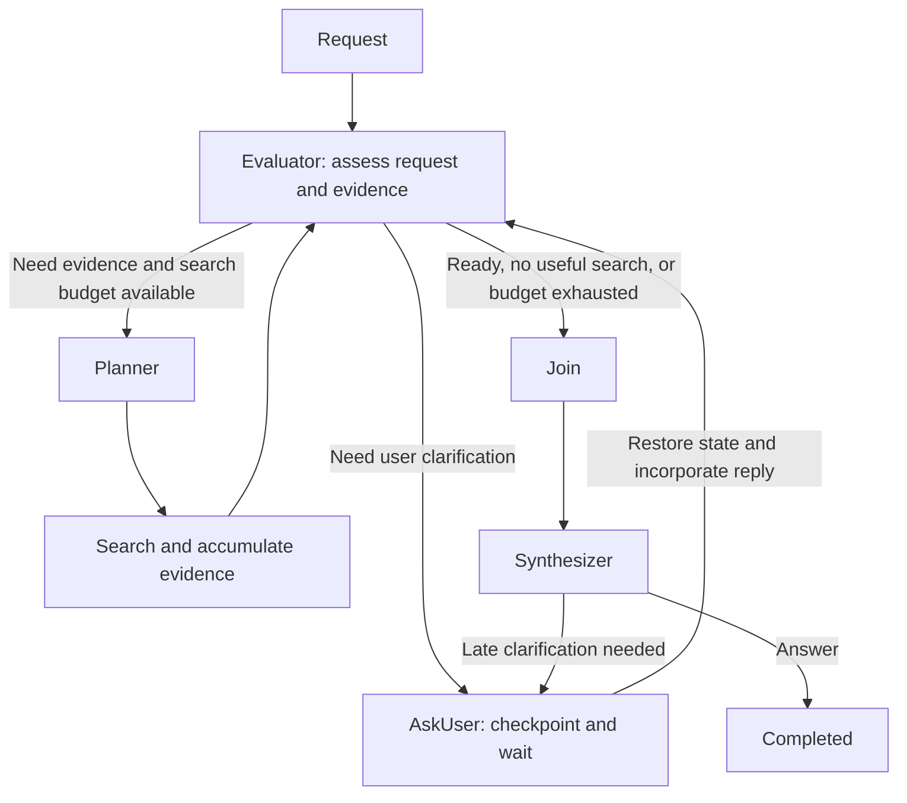

# Agentic reflection loop and durable checkpoints

**Status:** Proposed high-level design

## Purpose

Improve agentic answers through a bounded decision loop that assesses the current request and available evidence, then chooses to search, ask the user, or synthesize. Allow an initial search pass and up to two targeted replanning passes. Make AskUser a durable pause in the same workflow, so a clarification reply can trigger a new decision without losing completed work.

Scope is the primary application's agentic mode. Non-agentic chat and the voice stack are outside this proposal.

## Current behavior

The workflow in [CompleteChatService](../../altus-ai-assistant/AltusAiAssistantApi/Services/CompleteChatService.cs) is `Planner → Search → Join → Synthesizer`. Join deduplicates citations and can fetch whole documents. The Synthesizer can call AskUser, which ends the current invocation and saves clarification questions as an assistant message.

Workflow state lives in memory. [ChatTurnStore](../../altus-ai-assistant/AltusAiAssistantApi/Services/Maf/ChatTurnStore.cs) persists conversation messages and citations, but not a resumable workflow. A clarification reply therefore enters a new workflow from the beginning.

This proposal develops the reflection and durability ideas noted in [Chat Feature Improvements](../chat-feature-improvements.md) and the [MAF adoption plan](../old/maf-adoption-plan.md). Delivery is outlined in the [iterative implementation plan](agentic-workflow-implementation-plan.md).

## Proposed workflow

The Evaluator is the shared assessment step at entry, after search, and after a clarification reply. It chooses the next action from the current state. AskUser is available during assessment, allowing ambiguity to be resolved before unnecessary retrieval or synthesis.

| Stage | Responsibility |
| --- | --- |
| Planner | Produce an initial search plan, or revise it using evaluator feedback, earlier searches, and accumulated evidence. |
| Search | Execute the plan and add results to the workflow's evidence collection. Reuse completed searches where applicable. |
| Evaluator | Assess request clarity and evidence coverage; choose targeted search, AskUser, or synthesis. At entry, missing evidence normally leads to the initial search plan. |
| AskUser | Persist a pending clarification, pause the run, and return the reply with restored state to the Evaluator. |
| Join | Prepare the accumulated evidence for synthesis, including citation deduplication and existing whole-document retrieval. |
| Synthesizer | Produce a grounded answer, acknowledge remaining limitations, or ask the user for necessary clarification. |

The Evaluator returns a decision and concise, actionable feedback, such as an ambiguity, missing topic, or alternative search direction. It does not draft or repeatedly critique the final answer. On the first pass it assesses retrieved evidence before Join's whole-document expansion; after a pause it can also reuse any prepared context already saved.

The Synthesizer retains AskUser for ambiguities discovered while writing. Replies always return to the shared assessment step, so they can lead to another search when needed. Join reuses prepared context where applicable and refreshes it when the request or evidence changes.

Replanning targets unresolved gaps and preserves useful earlier results. It may change search terms or permitted sources, but must preserve client boundaries, authorization, and content exclusion/focus rules.

## Bounded reflection

- The first dispatch to Planner starts the initial search pass and does not consume a reflection return. Asking the user before that pass does not consume one either.
- Each subsequent dispatch to Planner consumes one return. Allow **at most two returns**, giving an initial pass plus up to two additional Planner–Search–Evaluator passes across the entire run.
- The workflow controller enforces this limit independently of the model's decision. Persist the counter; clarification, recovery, and transient retries do not reset it.
- Proceed to Join when evidence is sufficient, another search is unlikely to help, or the limit is reached. Avoid repeating equivalent plans that yield no new evidence.
- At the limit, synthesize from the available evidence and state material gaps. AskUser is appropriate for missing user intent or constraints, not as a way to replenish the search budget.

Stage failures are execution failures, not evaluator requests to replan. They must not produce an empty successful answer or consume another reflection return merely because a stage is retried.

## Durable workflow state

Introduce a persisted workflow run associated with the chat session and its initiating request. One run can span several user/assistant exchanges. Conversation history remains the user-visible record; a checkpoint records the execution state needed to continue that run.

Use durable shared storage so another API instance can recover the run after a restart. Prefer Microsoft Agent Framework's checkpoint and external request/response mechanisms, subject to verification against the installed version. Capture completed workflow progress and pending user requests before exposing an AskUser pause. Coordinate checkpoint storage with chat-message persistence; exact checkpoint boundaries follow the framework's execution model.

A checkpoint contains, at a high level:

- Run identity, session/client ownership, lifecycle status, and the next stage to execute.
- Original request, relevant conversation context, clarified intent, and applicable run settings.
- Current plan, completed searches, accumulated evidence and citation references, and prepared synthesis context when available.
- Evaluation feedback, whether the initial search pass has started, returns already used, and cumulative usage/budget information.
- Pending clarification and its identity, accepted replies, and checkpoint/workflow version.

Persist enough evidence, or durable references to it, to resume without repeating completed retrieval. Store task state and concise evaluation outcomes rather than private model reasoning. Do not depend on an in-memory agent, open HTTP request, or SignalR connection for recovery.

Run states are **Running**, **Waiting for user**, **Completed**, **Failed**, and **Cancelled**. Recovery continues from the last committed checkpoint. An interrupted stage may need to execute again, but completed stages and persisted conversation messages must not be duplicated. A run must have only one active continuation at a time.

## AskUser pause and resume

1. The Evaluator or Synthesizer requests clarification. Persist the pending question and a continuation back to assessment, retaining any existing plan, evidence, prepared Join output, and search budget state.
2. Save the clarification exchange and mark the run Waiting for user before presenting the question as ready for a reply. The response stream ends, while the workflow remains resumable.
3. Associate the user's reply with the pending clarification and run. Recheck session access and applicable content permissions before reusing saved evidence.
4. Restore the checkpoint, attach the reply to the clarified request, and resume the Evaluator. It chooses synthesis with existing evidence, a targeted search within the remaining budget, or another essential clarification. Completed searches are retained rather than automatically repeated.
5. Continue the chosen branch. Persist the resulting answer and complete the run, or save a new pause if essential clarification is still missing.

For example, after evidence has been gathered for two projects, the system asks which project the user means. If the reply selects one already covered, assessment leads to synthesis using saved evidence. If it adds a constraint such as "only deliveries last quarter" that the evidence cannot establish, assessment leads to a targeted search when budget remains.

Any return to Planner after clarification uses the same two-return budget. If it is exhausted, the answer explains what the available evidence cannot establish. A clearly new request starts a separate run; it must not silently consume a pending clarification.

Duplicate reply submissions or reconnects must resume a clarification only once. Persist each conversation exchange once, retaining the original request without inserting it again on every resume. If a checkpoint is expired or incompatible, explain that the run cannot resume and offer an explicit restart instead of silently beginning again.

## User experience and operational visibility

Show concise progress for searching, evaluating, refining the search, and preparing an answer. Distinguish Waiting for user from workflow completion, and restore that status after a page reload. A new connection attaches to the persisted run rather than creating another one.

Record run/stage outcomes, reflection count, pause/resume events, duration, and usage. Apply bounded execution budgets across continuations and define retention for abandoned checkpoints. Revalidate access on resume; evidence that is no longer permitted must not enter the answer.

## Delivery and acceptance

Introduce durable run state and continuation handling, then add the Evaluator and bounded loop. Deliver behind an agentic-mode feature flag and compare answer quality, latency, and model/search usage before wider rollout. Exact storage schema, framework checkpoint APIs, and transport contracts belong in implementation design.

Acceptance scenarios:

- An ambiguous initial request can trigger AskUser before search. A clear request leads to an initial search when evidence is needed.
- Sufficient evidence reaches synthesis after one pass; weak evidence can trigger targeted replanning but never more than two returns.
- Evidence from earlier passes remains available, and exhaustion produces an honest answer about remaining gaps.
- An AskUser reply resumes assessment with saved context, including after an API restart or on another instance.
- Replies supported by saved evidence reach synthesis without another search; replies exposing evidence gaps trigger targeted search only when budget remains.
- Reflection limits survive clarification pauses and recovery; a changed intent cannot reset them within the same run.
- Duplicate replies and recovery do not duplicate messages or start concurrent continuations.
- Failed execution is surfaced as failure, and unauthorized or expired continuations cannot silently reuse saved evidence.

## Pattern references

This design combines retrieval refinement with durable human-in-the-loop execution. It is an application-specific composition of established patterns, not a prescribed framework workflow.

- [LangChain workflow and agent patterns](https://docs.langchain.com/oss/python/langgraph/workflows-agents): conditional agent loops and evaluator–optimizer workflows.
- [Microsoft Agent Framework human-in-the-loop](https://learn.microsoft.com/en-us/agent-framework/workflows/human-in-the-loop): external requests and resuming with user responses.
- [Microsoft Agent Framework checkpoints](https://learn.microsoft.com/en-us/agent-framework/workflows/checkpoints): saved execution state and pending requests.
